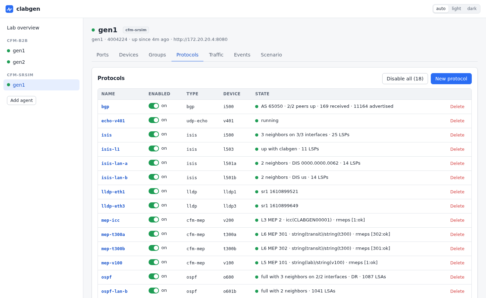
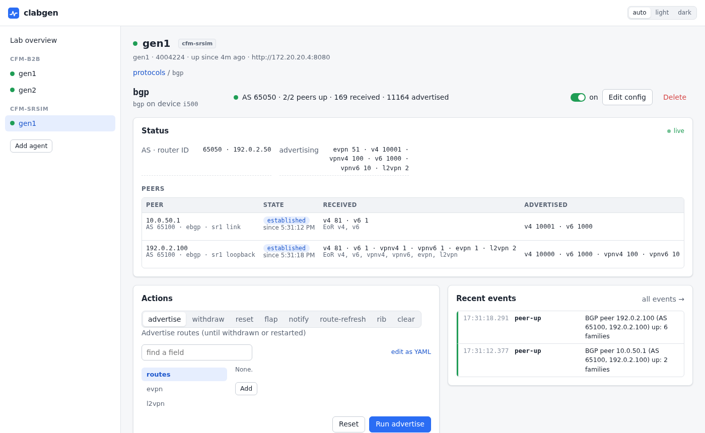

# clabgen

A web UI for emulating protocols and generating traffic in
[containerlab](https://containerlab.dev) labs, aimed at control-plane
testing: build emulated routers, MEPs and traffic endpoints, watch their
state live, and break them on purpose. A small agent runs as a clab node,
takes over the node's data interfaces and emulates endpoints on them.



## Quick start

Add clabgen nodes to a topology:

```yaml
name: demo
topology:
  nodes:
    gen1: {kind: linux, image: ghcr.io/ripnet/clabgen, binds: [".:/clab"]}
    gen2: {kind: linux, image: ghcr.io/ripnet/clabgen, binds: [".:/clab"]}
  links:
    - endpoints: [gen1:eth1, gen2:eth1]
```

```sh
containerlab deploy -t demo.clab.yml
```

Start the UI once per lab host; it finds every clabgen node in every
running lab:

```sh
docker run -d --name clabgen-ui --network host --restart unless-stopped \
  -v /var/run/docker.sock:/var/run/docker.sock ghcr.io/ripnet/clabgen-ui
```

Open http://127.0.0.1:8090 (from a laptop: `ssh -L 8090:127.0.0.1:8090
labhost`). The agents start empty: add devices and protocols in the UI,
or [load a scenario file](docs/configuration.md) at startup. What you
build is saved in `clab-demo/<node>/clabgen.yml` (that's the `.:/clab`
bind) and comes back when the lab restarts. Two
complete labs are in [`examples/`](examples): two agents back to back
(`b2b`), and one against a Nokia SR-SIM router (`srsim`, which needs an
SR-SIM image and license).

## Highlights

- **Everything from the browser**: a lab-wide view of every agent, live
  protocol status, and a config editor generated from each protocol's
  schema, with the changes reviewed before they are applied.
- **Break things on purpose**: flap adjacencies, withdraw routes, stop
  CCMs, inject CFM faults, silence BFD, restart gracefully, disable a
  protocol (or 20 random members of a group) and watch the device under
  test react.
- **Scale**: device groups of thousands of peers with stepped VLANs and
  addresses, emulated IS-IS and OSPF networks behind a router, route
  injection by the thousand.
- **Measure and judge**: traffic flows with loss, outages and RTT, and
  pass/fail limits on them shown across the whole lab ("every flow stayed
  under 50 ms of outage"); one-way stats on every device; Y.1731 delay and
  loss sessions in bins.
- **Scriptable**: the same things through [`clabgenctl`](docs/cli.md), an
  [API](docs/api.md), YAML scenarios, and a [Python package](docs/python.md)
  with pytest fixtures for turning a lab into a test suite.
- **Kept across restarts**: what you build is saved in the lab's folder
  (`clab-<lab>/<node>/clabgen.yml`) and restored when the lab comes back.

## Features

- **Devices**: many emulated endpoints per port (MAC, VLAN or QinQ,
  IPv4/IPv6 answering ARP, ND and ping), and device groups.
- **ETH-CFM / Y.1731**: down MEPs with CCM and defects, loopback,
  linktrace, delay (DMM, 1DM), loss (SLM, LMM), test signal, AIS/LCK/CSF,
  proactive measurement sessions and fault injection.
- **IS-IS**: point-to-point and LAN, L1/L2, multi-topology, SR-MPLS,
  SRv6 and flex-algo, keychain authentication, BFD, graceful restart.
- **OSPFv2 / OSPFv3**: areas (stub, NSSA, virtual links), segment routing,
  BFD, graceful restart.
- **BGP**: IPv4/IPv6 unicast, VPNv4/v6, EVPN and L2VPN.
- **Emulated topologies** behind IS-IS and OSPF routers (grids, rings,
  custom graphs) with link and node failures.
- **LLDP**.
- **Traffic flows**: ICMP (ping or crafted packets), UDP, and raw L2
  streams for testing circuits without an IP stack, one way or echoed.
- **Packet capture**: every frame the ports send and receive, live in the
  UI (decoded, filtered, saved as pcapng, or rebuilt as a packet flow), in
  `clabgenctl capture`, or straight in Wireshark: a plugin lists every
  agent's ports as capture interfaces.
- **Packet builder**: frames of any layers (Ethernet, VLAN, MPLS, ARP,
  IPv4/6, UDP, TCP, ICMP, VXLAN, raw bytes) with every field settable,
  fields changed per packet (increment, random, lists), and pcap replay;
  a layered editor in the UI with a live hex preview.

Interop is verified against Nokia SR-SIM.



## Intended use

clabgen is for lab and test networks. An agent takes over its node's
interfaces and sends real protocol traffic (BGP updates, IS-IS and OSPF
floods, CFM, traffic flows), and its API and UI have no authentication:
keep it on lab networks, away from production ones.

## Documentation

Also at **https://clabgen.dev/**.

- [Web UI](docs/ui.md): the lab-wide UI and its options
- [Configuration](docs/configuration.md): scenario files, each protocol,
  device groups
- [CLI](docs/cli.md): `clabgenctl`
- [API](docs/api.md)
- [Python and pytest](docs/python.md): the `clabgen` package
- [Development](docs/development.md): building, tests, images and releases
- [Writing a protocol](docs/writing-a-protocol.md)

## License

BSD 3-Clause; see [LICENSE](LICENSE). Copyright (c) 2026, Tom Young and
the clabgen contributors.
