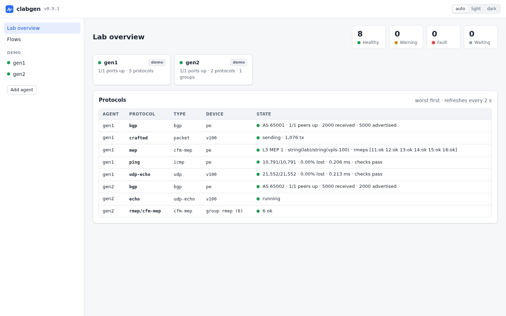

# clabgen

Your [containerlab](https://containerlab.dev) topology has the routers
you want to test. clabgen gives them something to talk to: BGP peers,
IS-IS and OSPF neighbors with whole networks behind them, CFM MEPs, and
traffic flows that measure loss and outages. Build them in your browser,
watch every session live, then break things on purpose (flap an
adjacency, withdraw a thousand routes, silence BFD) and see how your
routers react.

clabgen is just another containerlab node: add it to a topology, link it
to your routers, and drive it from the web UI, the CLI, the API, YAML
scenarios, or Python and pytest.

<picture>
  <source media="(prefers-color-scheme: dark)" srcset="docs/images/tour-dark.webp">
  
</picture>

## Quick start

You need a Linux host with Docker and
[containerlab](https://containerlab.dev/install/).

### 1. Add agents to a lab

Each clabgen agent is an ordinary node. Save this as `demo.clab.yml`:

```yaml title="demo.clab.yml"
name: demo
topology:
  nodes:
    gen1: {kind: linux, image: ghcr.io/ripnet/clabgen, binds: [".:/clab"]}
    gen2: {kind: linux, image: ghcr.io/ripnet/clabgen, binds: [".:/clab"]}
  links:
    - endpoints: [gen1:eth1, gen2:eth1]
```

and deploy it:

```sh
clab deploy -t demo.clab.yml
```

### 2. Start the UI

Once per lab host. It finds every clabgen node in every running lab, so
there is nothing to configure:

```sh
docker run -d --name clabgen-ui --network host --restart unless-stopped \
  -v /var/run/docker.sock:/var/run/docker.sock ghcr.io/ripnet/clabgen-ui
```

### 3. Open it

Browse to http://127.0.0.1:8090, pick an agent, and add devices and
protocols. From another machine, either:

- tunnel the port: `ssh -L 8090:127.0.0.1:8090 labhost`, then browse to
  http://127.0.0.1:8090, or
- have the UI listen on every interface: add `-listen 0.0.0.0:8090` after
  the image name, then browse to `http://labhost:8090`. The UI has no
  login, so only do this on a lab network.

Good to know:

- What you build is saved in `clab-demo/<node>/clabgen.yml` (that's what
  the `.:/clab` bind is for) and comes back when the lab restarts.
- Rather start from a file? [Load a scenario](docs/configuration.md) at
  startup.
- Two complete labs are in [`examples/`](examples): two agents back to
  back (`b2b`), and one against a Nokia SR-SIM router (`srsim`, which
  needs an SR-SIM image and license).

## Highlights

- **Everything from the browser**: a lab-wide view of every agent, live
  protocol status, and a config editor generated from each protocol's
  schema, with the changes reviewed before they are applied, and applied
  live: most edits take effect without dropping adjacencies or sessions.
- **Break things on purpose**: flap adjacencies, withdraw routes, stop
  CCMs, inject CFM faults, silence BFD, restart gracefully, disable a
  protocol (or 20 random members of a group) and watch the device under
  test react.
- **See every packet**: capture what any port sends and receives, live
  in the UI (decoded and filtered), saved as pcapng, or with
  `clabgenctl capture`.
- **Scale**: device groups of thousands of peers with stepped VLANs and
  addresses, built in a form that previews every member before anything
  is created; emulated IS-IS and OSPF networks behind a router; route
  injection by the thousand.
- **Measure and judge**: traffic flows with loss, outages and RTT, and
  pass/fail limits on them shown across the whole lab ("every flow stayed
  under 50 ms of outage"); one-way stats on every device; Y.1731 delay and
  loss sessions in bins.
- **Scriptable**: the same things through [`clabgenctl`](docs/cli.md), an
  [API](docs/api.md), YAML scenarios, and a [Python package](docs/python.md)
  with pytest fixtures for turning a lab into a test suite.
- **Kept across restarts**: what you build is saved in the lab's folder
  (`clab-<lab>/<node>/clabgen.yml`) and restored when the lab comes back.

## Features

- **Devices**: many emulated endpoints per port (MAC, VLAN or QinQ,
  IPv4/IPv6 answering ARP, ND and ping), and device groups.
- **ETH-CFM / Y.1731**: down MEPs with CCM and defects, loopback,
  linktrace, delay (DMM, 1DM), loss (SLM, LMM), test signal, AIS/LCK/CSF,
  proactive measurement sessions and fault injection; groups of MEPs (a
  hundred remote MEPs in one VPLS, say).
- **IS-IS**: point-to-point and LAN, L1/L2, multi-topology, SR-MPLS,
  SRv6 and flex-algo, keychain authentication, BFD, graceful restart.
- **OSPFv2 / OSPFv3**: areas (stub, NSSA, virtual links), segment routing,
  BFD, graceful restart.
- **BGP**: IPv4/IPv6 unicast, VPNv4/v6, EVPN, L2VPN, and SR policies
  (clabgen as the controller: candidate paths, binding SIDs, color
  steering); BFD.
- **Emulated topologies** behind IS-IS and OSPF routers (grids, rings,
  custom graphs) with link and node failures.
- **LLDP**.
- **DHCP**: clients (DHCPv4, and DHCPv6 with prefix delegation) leasing a
  device's addresses and gateway, and servers with a pool per client
  subnet that answer through relays and show what each relay inserted.
- **Traffic flows**: ICMP (ping or crafted packets), UDP, and raw L2
  streams for testing circuits without an IP stack, one way or echoed.
- **Packet capture**: every frame the ports send and receive, live in the
  UI (decoded, filtered, saved as pcapng, or rebuilt as a packet flow), or
  in `clabgenctl capture`.
- **Packet builder**: frames of any layers (Ethernet, VLAN, MPLS, ARP,
  IPv4/6, UDP, TCP, ICMP, VXLAN, raw bytes) with every field settable,
  fields changed per packet (increment, random, lists), and pcap replay;
  a layered editor in the UI with a live hex preview.

Interop is verified against Nokia SR-SIM.

<picture>
  <source media="(prefers-color-scheme: dark)" srcset="docs/images/bgp-dark.png">
  
</picture>

## Intended use

clabgen is for lab and test networks. An agent takes over its node's
data interfaces (eth1 and up; the management interface is left alone)
and sends real protocol traffic (BGP updates, IS-IS and OSPF floods,
CFM, traffic flows). Its API and UI have no authentication, so keep it
on lab networks, away from production ones.

## Documentation

<!-- github-only -->
Also at **https://clabgen.dev/**.
<!-- /github-only -->

- [Web UI](docs/ui.md): the lab-wide UI and its options
- [Configuration](docs/configuration.md): scenario files, saving, ports
  and devices
- [Traffic flows](docs/flows.md) and [device groups](docs/device-groups.md)
- Protocols: [CFM and Y.1731](docs/cfm.md), [IS-IS](docs/isis.md),
  [BGP](docs/bgp.md), [OSPF](docs/ospf.md), [LLDP](docs/lldp.md),
  [DHCP](docs/dhcp.md)
- [CLI](docs/cli.md): `clabgenctl`
- [API](docs/api.md)
- [Python and pytest](docs/python.md): the `clabgen` package
- [Upgrading](docs/upgrading.md): the UI, agents, `clabgenctl` and Python
- [Development](docs/development.md): building, tests, images and releases
- [Writing a protocol](docs/writing-a-protocol.md)

## License

BSD 3-Clause; see [LICENSE](LICENSE). Copyright (c) 2026, Tom Young and
the clabgen contributors.
