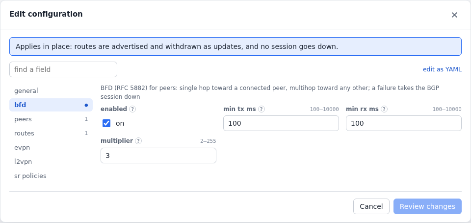

# BGP

BGP runs on a device with addresses. Its TCP is the device's, so it can
peer from loopbacks too.

```yaml
  - name: bgp
    type: bgp
    device: i500
    config: {local_as: 65050, router_id: 192.0.2.50, hold_time: 30,
             peers: [{address: 10.0.50.1, remote_as: 65100, families: [ipv4-unicast, ipv6-unicast]},
                     {address: 192.0.2.100, remote_as: 65100, local_address: 192.0.2.50, ttl: 64}],
             routes: [{prefix: 100.64.0.0/24, count: 10000, communities: ["65050:1"], large_communities: ["65050:1:1"]},
                      {prefix: "2001:db8:abc::/48", count: 1000, med: 50}]}
```

There is no TCP MD5 authentication (the netstack has none).

## Actions

- `advertise routes='[{"prefix":"101.0.0.0/24","count":200000}]'` and
  `withdraw`.
- `reset peer=10.0.50.1`.
- `flap peer=… seconds=30 mode=silent` (the peer's hold timer expires), or
  `mode=notify`.
- `notify code=6 subcode=2 message="maintenance"`.
- `route-refresh`, and `rib peer=10.0.50.1 prefix=…` for received routes.
- `bfd-fail peer=… seconds=5` (see [BFD](#bfd)).

For example, `clabgenctl proto run bgp reset peer=10.0.50.1`.

## Changing a running speaker

Config edits apply without dropping sessions where they can (see
[editing a running protocol](configuration.md#editing-a-running-protocol)):

- Added, changed and removed routes and SR policies go out as UPDATEs and
  withdrawals, and peers are added or removed on their own.
- A peer's session resets only when its `remote_as`, `local_address`,
  `families`, `hold_time` (its own or the speaker's default), `ttl` or
  `bfd` changes.
- A new `local_as`, `router_id` or speaker-wide `bfd` restarts the
  speaker.
- Routes added with `advertise` survive edits, unless an edit advertises
  or withdraws the same prefixes.

## BFD

BFD (RFC 5882) runs with each Established session: single hop (RFC 5881)
toward a peer on a connected subnet, multihop (RFC 5883, UDP 4784) toward
any other, such as a loopback. It is off unless enabled.

- A BFD session that fails after being up takes the BGP session down
  (Cease, BFD Down) much sooner than the hold timer.
- The peer turning BFD off (AdminDown) doesn't.
- A peer's `bfd` overrides the speaker's `enabled`.
- `bfd-fail peer=… seconds=5` silences our side, to test the router's
  reaction.

<!-- tab: YAML -->
```yaml
- name: bgp
    type: bgp
    device: pe
    config: {local_as: 65001, bfd: {enabled: true, min_tx_ms: 100, min_rx_ms: 100, multiplier: 3},
             peers: [{address: 192.0.2.2, remote_as: 65002}],
             routes: [{prefix: 100.64.0.0/24, count: 5000, communities: ["65001:100"]}]}
```
<!-- tab: UI -->
<picture>
  <source media="(prefers-color-scheme: dark)" srcset="images/form-bgp-dark.png">
  
</picture>
<!-- /tabs -->

## VPN families

Peer `families` add `ipv4-vpn`, `ipv6-vpn`, `evpn` and `l2vpn` (and the
[SR policy](#sr-policies) families):

- **VPNv4 / VPNv6**: a route with an `rd`, with `label` and
  `route_targets`. The VPNv6 next hop is IPv4-mapped over IPv4, as 6VPE.
- **EVPN** (`evpn` entries): MAC/IP (counting MACs and IPs up), inclusive
  multicast (PMSI tunnel, ingress replication), Ethernet A-D (ESI label,
  single-active), Ethernet segment and IP prefix routes. They use MPLS
  labels or VXLAN VNIs (`encapsulation`), with MAC mobility and the
  router's MAC.
- **L2VPN** (`l2vpn` entries): BGP VPLS (RFC 4761) or VPWS (RFC 6624) label
  blocks (`ve_id`, `block_offset`, `block_size`, `label_base`, Layer2 Info
  MTU and control word).

```yaml
             routes: [{prefix: 10.205.0.0/24, count: 100, rd: "65050:500", label: 5000, route_targets: ["65100:500"]}],
             evpn: [{type: mac-ip, rd: "65050:600", route_targets: ["65100:600"], mac: "02:00:00:06:00:01", ip: 10.206.0.1, count: 50, label: 6000},
                    {type: inclusive-multicast, rd: "65050:600", route_targets: ["65100:600"], label: 6001}],
             l2vpn: [{kind: vpws, rd: "65050:800", route_targets: ["65100:800"], ve_id: 2, label_base: 800000, block_size: 2}]
```

Received routes of these families show in the `rib` action (filter by
text, e.g. `65100:500` or `mac:02:00`).

> **SR OS and eBGP:** Over eBGP, SR OS drops VPN routes under its RFC 8212 default reject
> (`vpn-apply-import` is off, so the group's import policy doesn't apply
> to them). Set `ebgp-default-reject-policy import false export false`
> on the group, or use iBGP.

## SR policies

clabgen can be the controller that hands SR policies to headends: family
`ipv4-srpolicy` / `ipv6-srpolicy` (BGP SR Policy, RFC 9830), one route per
candidate path. A headend installs the candidate path with the highest
preference among the valid ones and steers traffic into it: traffic to
the binding SID, and BGP routes with the policy's color.

```yaml
             peers: [{address: 192.0.2.100, remote_as: 65100, families: [ipv4-unicast, ipv4-srpolicy]}],
             sr_policies:
               - {endpoint: 192.0.2.50, color: 100, headend: 192.0.2.100, preference: 200,
                  binding_sid: 32050, segment_lists: [{labels: [20050]}]}
               - {endpoint: 192.0.2.50, color: 100, headend: 192.0.2.100, distinguisher: 2, preference: 100,
                  segment_lists: [{labels: [20003, 20050], weight: 1}, {labels: [20004, 20050], weight: 2}]}
             routes: [{prefix: 198.51.100.0/24, ext_communities: ["color:100"]}]   # steered into color 100
```

- `endpoint` and `color` name the policy; `distinguisher` tells its
  candidate paths apart (default 1: give each candidate path of a policy
  its own).
- `headend`: the BGP identifier of the router that should install it (a
  route target `<headend>:0`). Without it the route carries NO_ADVERTISE,
  for when the headend is the BGP peer itself.
- Each candidate path has a `preference` (default 100), segment lists of
  SR-MPLS labels outermost first (with optional `weight`s to split
  traffic), an optional `binding_sid`, and, among the advanced options,
  the S and I binding-SID flags, `priority`, `explicit_null`, and policy
  and candidate path names.
- `color:N` in a route's `ext_communities` steers that route into the
  policies of color N.
- `advertise` and `withdraw` take `sr_policies` too, to change candidate
  paths while traffic runs (e.g. withdraw the preferred one and measure
  the failover).

> **SR OS:** it takes them with `bgp sr-policy-import true`, `family
> sr-policy-ipv4` on the group and `segment-routing sr-policies
> admin-state enable` (plus a `reserved-label-block` for binding SIDs);
> `show router segment-routing sr-policies bgp` shows what it installed.
> Send traffic to a binding SID over an interface that forwards MPLS (an
> IS-IS or OSPF segment-routing link): a plain IES interface drops
> labelled packets.
