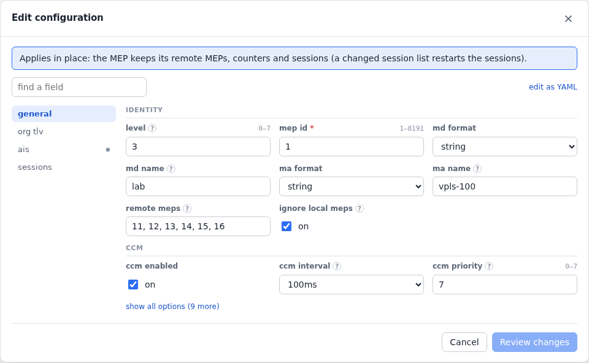

# CFM and Y.1731

A down MEP (802.1ag, Y.1731) runs on a [device](configuration.md#devices),
untagged or on its VLANs:

<!-- tab: YAML -->
```yaml
protocols:
  - name: mep
    type: cfm-mep
    device: pe
    config: {level: 3, mep_id: 1, remote_meps: [11, 12, 13, 14, 15, 16], md_format: string, md_name: lab,
             ma_name: vpls-100, ccm_interval: 100ms}
```
<!-- tab: UI -->
<picture>
  <source media="(prefers-color-scheme: dark)" srcset="images/form-mep-dark.png">
  
</picture>
<!-- /tabs -->

## Remote MEPs

- `remote_meps` lists the MEP IDs a MEP expects. A CCM from any other
  raises DefErrorCCM, and an empty list learns remote MEPs as they appear.
- `ignore_unknown_meps: true` ignores CCMs from MEP IDs not in
  `remote_meps` instead of raising DefErrorCCM.
- MEPs on the same port of an agent (a [device group](device-groups.md) of
  remote sites, say) don't hear each other's CCMs, just as sites behind a
  router's down MEP wouldn't. `ignore_local_meps: false` lets them.
- Each MEP sends its first CCM at a random point of its interval, so a
  group's CCMs are spread out rather than sent in one burst.

## Y.1731

Beyond CCM, these are actions:

- `loopback` and `linktrace`.
- `delay` (DMM) and `one-way-delay` (1DM; the receiving MEP shows the
  delay, since agents on one host share a clock).
- `synthetic-loss` (SLM) and `loss` (LMM, over the devices' data-frame
  counters: every non-CFM frame they send and receive, a flow's for
  example).
- `test-signal`: TST with a null or PRBS pattern and an optional CRC. The
  receiver counts loss, reordering and bit errors.
- `fault`: stops CCMs, forces AIS, locks (LCK) or sends CSF.

`ais: {enabled: true, client_level: 6}` sends AIS while the MEP has a
defect. `sessions` measure continuously, kept in bins:

```yaml
    config: {…, sender_id: gen1,
             sessions: [{name: dm, type: delay, target_mep_id: 1, interval_ms: 1000, bin_s: 60, bins: 10},
                        {name: sl, type: synthetic-loss, target_mep_id: 1, interval_ms: 100}]}
```
