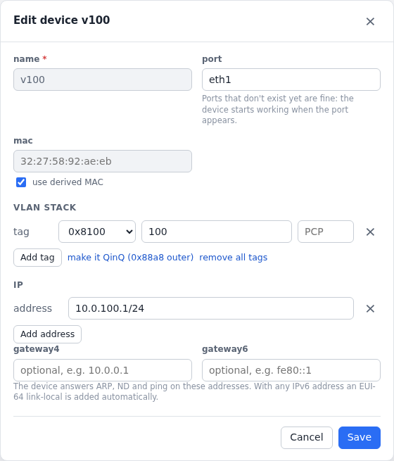

# Configuration

An agent's ports, devices and protocols are its **scenario**. You can
build it in the web UI, change it with `clabgenctl` or the API, or load it
from a YAML file when the agent starts. Either way it is
[kept across lab restarts](#saved-config).

Every protocol's full set of options, with descriptions and defaults, is
in its schema: the UI's forms show them, and `clabgenctl types <type>`
prints them. This page covers scenario files, saving, ports and devices;
each protocol has its own page with typical configs:

- [Traffic flows](flows.md): ICMP, UDP, raw L2 streams, the packet
  builder and pass/fail checks
- [Device groups](device-groups.md): many devices from one template
- [CFM and Y.1731](cfm.md), [IS-IS](isis.md), [BGP](bgp.md),
  [OSPFv2 and OSPFv3](ospf.md), [LLDP](lldp.md), [DHCP clients](dhcp.md)

[`examples/`](../examples) has two complete labs.

## Scenario files

### Loading one at start

Put the file next to the topology and name it in `CLABGEN_SCENARIO`:

```yaml
    gen1:
      kind: linux
      image: ghcr.io/ripnet/clabgen
      binds: [.:/clab]                   # needed to save config across lab restarts
      env: {CLABGEN_SCENARIO: gen1.yml}  # optional: a scenario to start a fresh lab with
```

- A relative path is relative to the topology's folder, like
  containerlab's own bind sources (`scenarios/gen1.yml` works too).
- An absolute path is a path inside the node. Without the `.:/clab` bind,
  mount the file yourself: `binds: [gen1.yml:/etc/clabgen/scenario.yml:ro]`
  and `CLABGEN_SCENARIO: /etc/clabgen/scenario.yml`.

The Scenario tab in the UI (or `clabgenctl scenario get` / `apply` /
`reset`) exports, applies and resets the whole thing.

### What's in one

```yaml
ports:                       # optional: admin state per data port
  eth1: {admin: up}
devices:                     # emulated endpoints on the ports
  - {name: v100, port: eth1, vlans: [{vid: 100}], addresses: [10.0.100.2/24], gateway4: 10.0.100.1}
device_groups: []            # many devices from one template (see Device groups)
protocols:                   # protocol instances and traffic flows, each on a device
  - name: ping-gw
    type: icmp
    device: v100
    config: {destination: 10.0.100.1, rate: 100, auto_start: true}
    disabled: false          # optional: keep the config, don't run it
```

| Type | What it is |
|---|---|
| `cfm-mep` | 802.1ag / Y.1731 down MEP ([CFM](cfm.md)) |
| `isis`, `ospf`, `ospfv3`, `bgp` | routing protocols ([IS-IS](isis.md), [OSPF](ospf.md), [BGP](bgp.md)) |
| `lldp` | LLDP agent ([LLDP](lldp.md)) |
| `dhcp`, `dhcpv6` | DHCP clients that lease a device's addresses ([DHCP clients](dhcp.md)) |
| `icmp`, `udp`, `l2`, `packet` | [traffic flows](flows.md) |
| `udp-echo`, `l2-echo` | responders that send flows back |

## Saved config

With the topology's folder mounted at `/clab` (`binds: [.:/clab]`, as in
the examples; clabgen v0.5.0 or newer), an agent saves its whole config to
`clab-<lab>/<node>/clabgen.yml` a moment after every change made in the
UI, CLI or API, and loads it when the lab starts again. The saved config
wins over `CLABGEN_SCENARIO`: the scenario file seeds a fresh lab, and
after that the lab keeps what was built on it.

| Command | Saved config |
|---|---|
| `docker restart`, `clab destroy` and `deploy`, `clab redeploy` | kept |
| `deploy --reconfigure`, `redeploy --cleanup`, `destroy --cleanup` | deleted with the lab folder: the next start is fresh |

The Scenario tab shows where the config is saved and where this start's
came from. **Reset** there (or `clabgenctl scenario reset`) deletes the
saved file and loads the topology's scenario again. That is also how
edits to the scenario file take effect on a lab that has a saved config.

The file is plain scenario YAML and yours to edit, but edit it while the
lab is stopped: a running agent reads it only at start, and saves over it
on its next change.

### In your own topology

Add the bind to each clabgen node (keeping its other binds), then
redeploy: mounts are fixed when a container is created.

```yaml
topology:
  nodes:
    traffic:
      kind: linux
      image: ghcr.io/ripnet/clabgen
      binds: [".:/clab"]
```

- containerlab adds binds under `defaults` to every node's own, so a lab
  of only clabgen nodes can say it once (`defaults: {binds: [".:/clab"]}`).
  In a lab with routers, keep it per node, or they get the folder too.
- Nothing else is needed: the scenario file stays optional, and without
  the bind the config simply isn't kept (the Scenario tab says so).
- Router kinds containerlab knows (`nokia_srsim`, …) don't need this:
  containerlab creates their node folder and mounts their flash into it.
  For `kind: linux`, the generic container, it does neither.

### Details

The bind is the topology's folder rather than the lab folder itself
because containerlab checks that bind sources exist before it creates the
lab folder, so `clab-<lab>/<node>` can't be mounted on a first deploy. The
agent finds its own folder through the variables containerlab sets
(`CLAB_LABEL_CLAB_NODE_LAB_DIR`) and writes nothing else.

- `CLABGEN_STATE=/path/clabgen.yml` names the file (outside containerlab
  too), and `CLABGEN_STATE=off` turns saving off.
- `CLABGEN_LAB_MOUNT` moves the mount point.
- A saved file that doesn't parse is renamed `clabgen.yml.unreadable`, and
  the scenario is used instead.

## Ports and link state

An agent adopts its node's data interfaces (`eth1` and up) as ports.
Taking a port down (`ports: {eth1: {admin: down}}`, `clabgenctl port down
eth1`, or the Ports tab) sets the agent's interface down. On a
containerlab veth link that drops carrier on the other end, so the router
sees the link fail. The other way round, the port shows oper down when the
other end drops carrier.

### Links to SR-SIM

Since containerlab 0.78, links to Nokia SR-SIM (`nokia_srsim`) nodes
default to `veth-stitch`: two veth pairs joined on the host by tc
redirects (`clab-stitch-…` interfaces). Frames pass through, but link
state doesn't: a port taken down on either side stays up on the other.
Where a test needs link failures, give that link `type: veth` in the long
form:

```yaml
links:
  - type: veth
    endpoints:
      - {node: gen1, interface: eth1}
      - {node: sr1, interface: 1/1/c1/1}
```

What that costs is impairments:

- On a stitched link, containerlab applies `clab tools netem` on the
  host side, which works in both directions. (The stitch exists because
  SR-SIM's own interfaces can't be impaired.)
- On a plain veth link, netem can only go on the agent's end
  (`clab tools netem set -n clab-<lab>-gen1 -i eth1 --delay 20ms`), which
  impairs what the agent sends and not what the router sends back.

Keep the default stitched link where you need impairments both ways, and
use `type: veth` where you need link state. A lab can mix the two, link by
link.

## Devices

A device is an emulated endpoint on a port: protocols and flows run on
devices, and a port can have as many as you like.

<!-- tab: YAML -->
```yaml
devices:
  - {name: v100, port: eth1, vlans: [{vid: 100}], addresses: [10.0.100.1/24]}
```
<!-- tab: UI -->
<picture>
  <source media="(prefers-color-scheme: dark)" srcset="images/form-device-dark.png">
  
</picture>
<!-- /tabs -->

- `port`: the data port it sits on.
- `mac`: optional. The default is derived from the host and device name,
  so it stays the same across restarts.
- `vlans`: the tag stack, outermost first. Each tag has a `vid`, and
  optionally a `tpid` (default 0x8100), `pcp` and `dei`. Without tags the
  device is untagged.
- `addresses`, `gateway4`, `gateway6`: IPv4 and IPv6 addresses with prefix
  lengths, and default gateways. A device with addresses answers ARP, ND
  and ping. Without them it is a plain L2 endpoint, which is all CFM, LLDP
  and L2 streams need, or a device for a [DHCP client](dhcp.md) to lease
  them.

More examples: IPv4 and IPv6 with a gateway, QinQ, and a fixed MAC.

```yaml
devices:
  - {name: v200, port: eth1, vlans: [{vid: 200}], addresses: [10.0.200.2/24, 2001:db8:200::2/64], gateway4: 10.0.200.1}
  - {name: qinq, port: eth2, vlans: [{tpid: 0x88a8, vid: 200}, {vid: 10}]}
  - {name: plain, port: eth3, mac: "02:00:00:00:03:01"}
```

## Editing a running protocol

A config edit (the UI's Edit config, `clabgenctl proto set`, the API, a
device group change) applies in place when it only changes what a protocol
advertises, so adjacencies and sessions stay up. The UI says before Apply
which it will be. Anything else restarts the instance with the new config.

| Protocol | Applied in place | Restarts the instance |
|---|---|---|
| BGP | routes, SR policies, EVPN/L2VPN, peers added or removed (a peer whose session settings change resets alone) | `local_as`, `router_id`, speaker-wide `bfd` |
| IS-IS | hostname, overload, metrics and TE attributes, prefixes, loopbacks, simulated topology, segment routing, flex-algo, SRv6, summaries, LSP timers | system ID, areas, levels, circuits, hellos, authentication, BFD, graceful restart, topologies, interfaces added or removed |
| OSPFv2 / OSPFv3 | costs and TE attributes, prefixes, loopbacks, max-metric, simulated topology (not its area), segment routing, flex-algo, LSA refresh | router ID (or the first loopback when it is the router ID), areas, interfaces, network types, timers, authentication, BFD, graceful restart, virtual links |
| CFM MEP | CCM on/off, priority and TLVs, `remote_meps`, AIS, responders, sessions (restarted on their own) | level, MEP ID, MD, MA, CCM interval |
| LLDP | everything else (the next LLDPDU goes out at once) | `dest`, `mode` |
| DHCP clients | | every edit (the lease is released first) |
| Traffic flows and others | | every edit |
