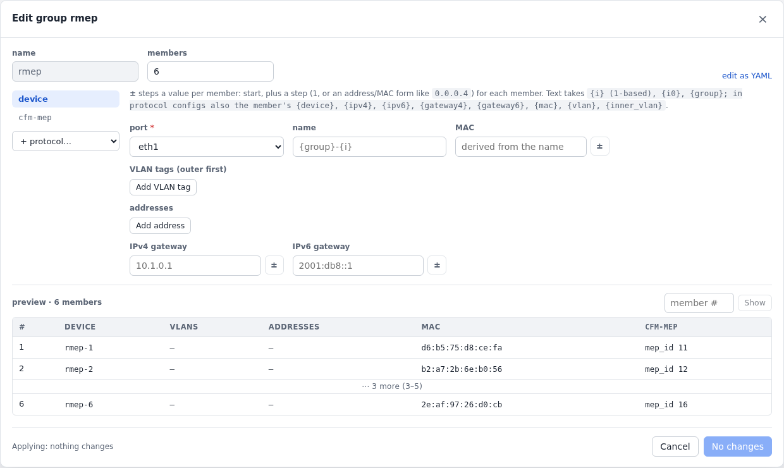

# Device groups

A device group is many devices from one template, each running the same
protocols: 200 BGP peers, 500 MEPs on 500 VLANs, a host per subnet.

```yaml
device_groups:
  - name: ce
    count: 200
    device:                       # named ce-1 … ce-200 unless it sets a name
      port: eth3
      vlans: [{vid: {start: 1000}}]
      addresses: [{start: 10.1.0.2/30, step: 0.0.0.4}]
      gateway4: {start: 10.1.0.1, step: 0.0.0.4}
    protocols:                    # instances ce-1-bgp … ce-200-bgp
      - type: bgp
        config:
          local_as: {start: 65001}
          peers: [{address: "{gateway4}", remote_as: 65100}]
          routes: [{prefix: {start: 172.16.0.0/24, step: 0.0.10.0}, count: 10, communities: ["65100:{i}"]}]
```

## Stepped values and placeholders

Any value in the device or protocol template can be stepped per member
with `{start, step, repeat, cycle}`:

- `start` is an integer, an IP address, an address with a prefix length,
  or a MAC.
- `step` is an integer, or a value of the same form (`0.0.0.4`, `::1:0`).
  The default is 1.
- Member `i` (from 0) gets `start + k·step`, with
  `k = (i / repeat) % cycle`. So QinQ is an outer VLAN with `repeat: 100`
  and an inner one with `cycle: 100`.

Strings take placeholders: `{i}` (from 1), `{i0}` (from 0) and `{group}`,
and in protocol configs the member's `{device}`, `{ipv4}`, `{ipv6}`,
`{gateway4}`, `{gateway6}`, `{mac}`, `{vlan}` and `{inner_vlan}`.

## In the UI

In the Groups tab (**New group**, or **Make group…** on a device in the
Devices tab), the device and each protocol are forms. `±` next to a
number, address or MAC turns it into a stepped value, and a preview shows
members as the agent renders them before anything is created.
`clabgenctl group add|set --dry-run` prints the same preview.

Six remote MEPs, one per member, with MEP IDs from 11:

<!-- tab: YAML -->
```yaml
device_groups:
  - name: rmep
    count: 6
    device: {port: eth1}
    protocols:
      - type: cfm-mep
        config: {level: 3, mep_id: {start: 11}, remote_meps: [1], md_format: string, md_name: lab,
                 ma_name: vpls-100, ccm_interval: 100ms}
```
<!-- tab: UI -->
<picture>
  <source media="(prefers-color-scheme: dark)" srcset="images/form-group-dark.png">
  
</picture>
<!-- /tabs -->
## Running a group

Members are ordinary devices and protocol instances: their pages, actions
and flows work as usual, but they change only through the group.

- Changing a group (`clabgenctl group set ce.yml`) keeps members whose
  rendered config is the same running, so the count can grow or shrink
  without touching the rest.
- `clabgenctl groups` summarises each group protocol by the protocols' own
  state (e.g. `198 established, 2 active`), and `group show ce` lists the
  members.
- `group run ce flap --members 1-20` (or `--random 5`) runs an action on a
  selection, in parallel.
- `group disable ce --members 2,5` (or `--random 3`) stops a group
  protocol on some members, keeping their config, until `group enable`.
  On every member (`group disable ce`), it is recorded in the spec as
  `disabled: true` on the group protocol, so it is exported with the
  scenario.
- Lists leave members out unless asked (`devices --all`,
  `protocols --group ce`).
