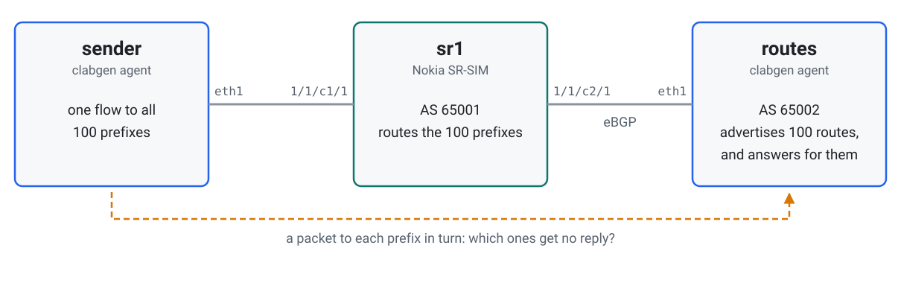
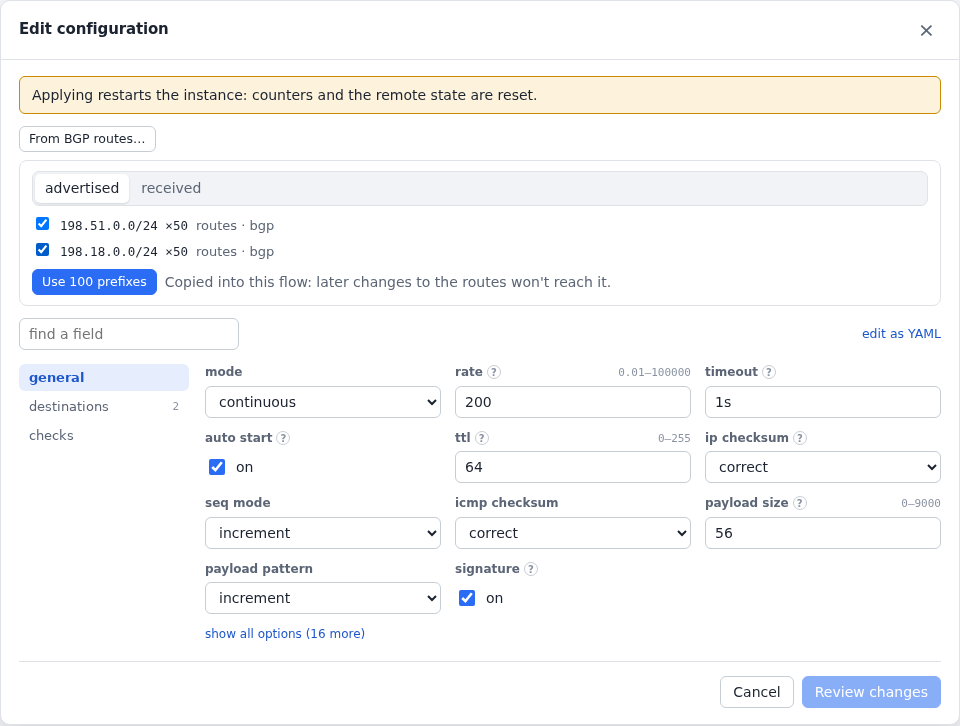
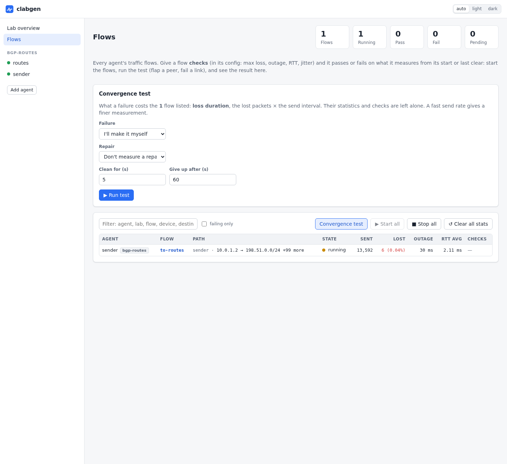
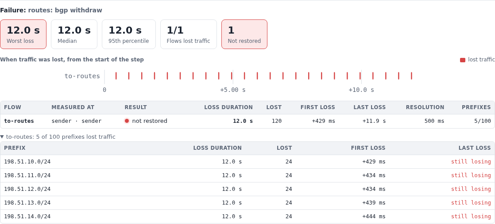

# Traffic to BGP routes

When a failure takes out some of your routes, which ones? Here one flow
sends to all 100 routes that a clabgen node advertises through a Nokia
SR-SIM, and a [convergence test](../flows.md#convergence-tests) names the
prefixes that lost traffic.

What it shows:

- clabgen answering for the routes it advertises, so traffic to them can be
  measured;
- [one flow to many prefixes](../flows.md#flows-to-many-prefixes), filled in
  from BGP routes in the UI;
- withdrawing five routes, and the test naming exactly those five.

The lab is in [`examples/bgp-routes`](../../examples/bgp-routes).

## Topology

<picture>
  <source media="(prefers-color-scheme: dark)" srcset="../images/examples/bgp-routes-topology-dark.svg">
  
</picture>

To deploy it, add `license: <file>` to the `sr1` node in
[`bgp-routes.clab.yml`](../../examples/bgp-routes/bgp-routes.clab.yml), then:

```sh
cd examples/bgp-routes && containerlab deploy -t bgp-routes.clab.yml
```

Give it a couple of minutes after the SR-SIM is up, until `to-routes` stops
losing traffic.

## The router

[`sr1.partial.txt`](../../examples/bgp-routes/sr1.partial.txt) has the two
interfaces and the eBGP session, accepting what it's sent:

```
/configure router "Base" autonomous-system 65001
/configure policy-options policy-statement "all" default-action action-type accept
/configure router "Base" bgp group "routes" peer-as 65002
/configure router "Base" bgp group "routes" import policy ["all"]
/configure router "Base" bgp neighbor "10.0.2.2" group "routes"
```

## The routes and the traffic

[`routes.yml`](../../examples/bgp-routes/routes.yml) advertises two blocks
of 50 routes. With no `next_hop`, clabgen is their next hop, so its device
also answers for them.

[`sender.yml`](../../examples/bgp-routes/sender.yml) has the flow. In the
UI, **From BGP routes…** in the flow's config lists what any agent
advertises and what a peer sent. Picking some copies them into the flow:

<!-- tab: UI -->
<picture>
  <source media="(prefers-color-scheme: dark)" srcset="../images/examples/bgp-routes-form-dark.png">
  
</picture>
<!-- tab: YAML -->
```yaml
devices:
  - {name: sender, port: eth1, addresses: [10.0.1.2/24], gateway4: 10.0.1.1}
protocols:
  - name: to-routes
    type: icmp
    device: sender
    config:
      destinations:
        - {prefix: 198.51.0.0/24, count: 50}
        - {prefix: 198.18.0.0/24, count: 50}
      rate: 200
      auto_start: true
```
<!-- /tabs -->

At 200 packets a second, each of the 100 prefixes gets a packet every
500 ms. That is the resolution per prefix. (SR-SIM starts dropping above a
few hundred packets a second, which is why 100 prefixes suits it; back to
back, 50,000 a second probes 1000 prefixes every 20 ms.)

## Which routes a failure hits

On the **Flows** page, **Convergence test** runs the failure and the repair.
Here the failure withdraws five routes (`bgp`'s `withdraw` action on the
`routes` agent), and the repair advertises them again.

<picture>
  <source media="(prefers-color-scheme: dark)" srcset="../images/examples/bgp-routes-actions-dark.webp">
  
</picture>

The same from the CLI:

```sh
export CLABGEN_LAB=bgp-routes
withdrawn='[{"prefix":"198.51.10.0/24","count":5}]'
clabgenctl convergence --settle 8s --max-wait 15s \
  --trigger "clabgenctl -s routes proto run bgp withdraw routes='$withdrawn'" \
  --restore "clabgenctl -s routes proto run bgp advertise routes='$withdrawn'"
```

<picture>
  <source media="(prefers-color-scheme: dark)" srcset="../images/examples/bgp-routes-failure-dark.png">
  
</picture>

Things to read from it:

- **The list names the five routes withdrawn**, and no others.
- **The flow isn't restored** while they stay withdrawn, though the other 95
  still reply. This test gives up after **Give up after**, so that's how long
  they stayed down.
- **Loss duration is the worst prefix's**, and the resolution the time
  between its packets: a route down for 15 s shows about 15 s, not the small
  share of the flow's packets it took.

Failing the link to `routes` instead hits every prefix, and the test says so:
100 of 100.

> **The flow keeps sending to withdrawn routes.** It copied them when you
> configured it, so traffic to a route the router no longer has is lost, which
> is what you want to see. Traffic doesn't follow later route changes.
