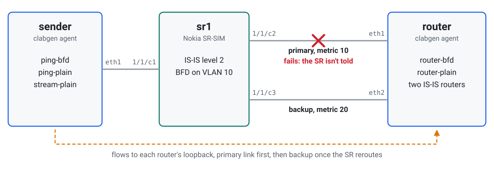
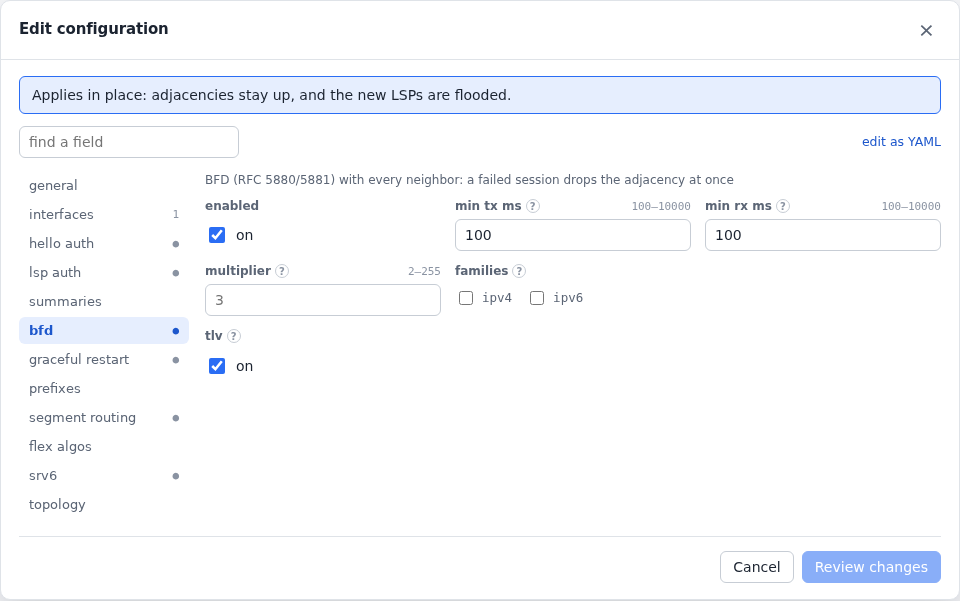
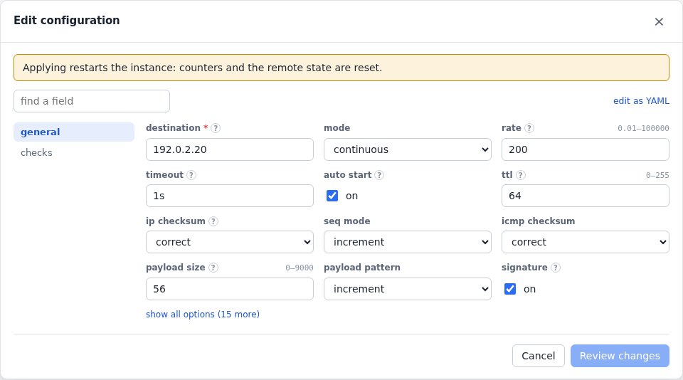
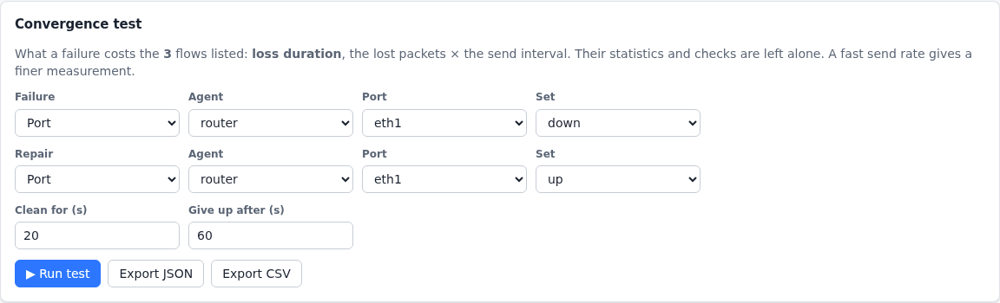
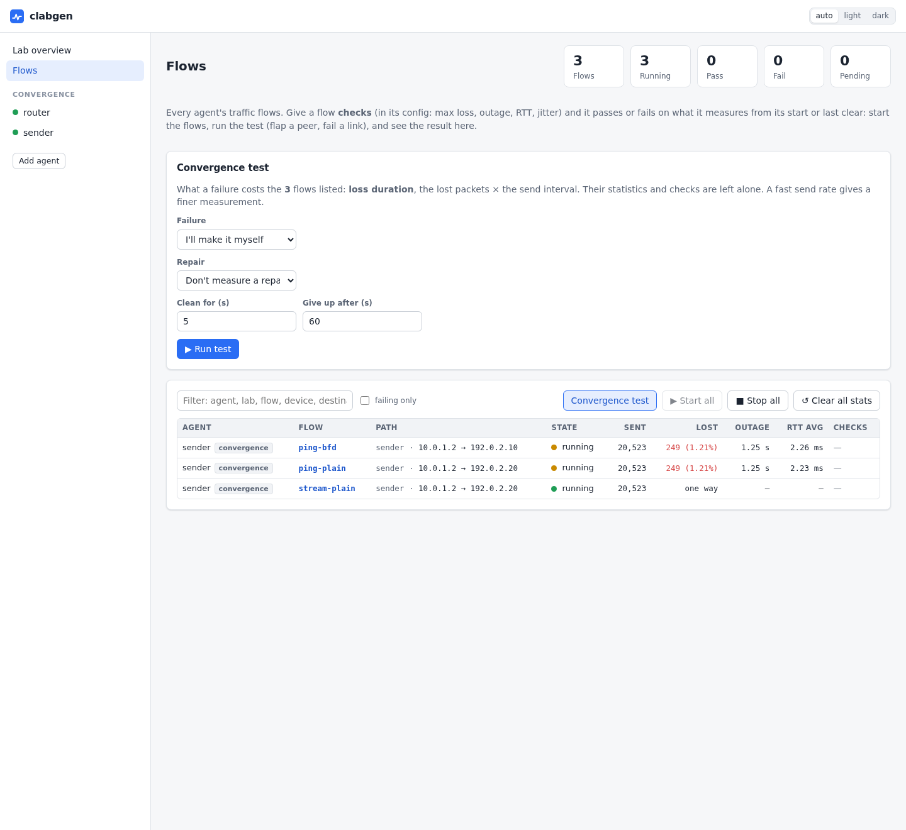
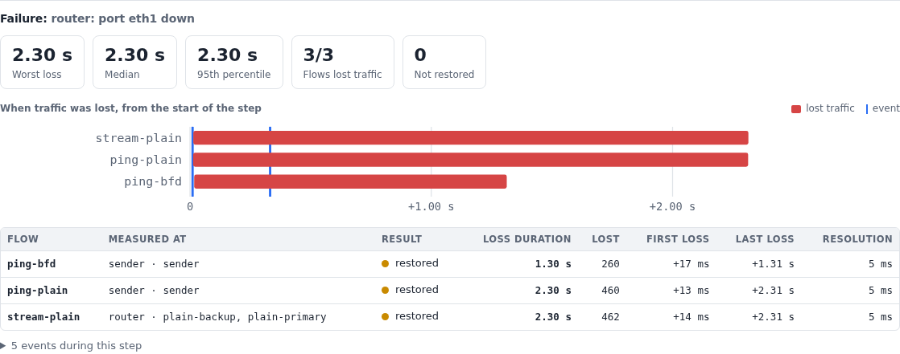
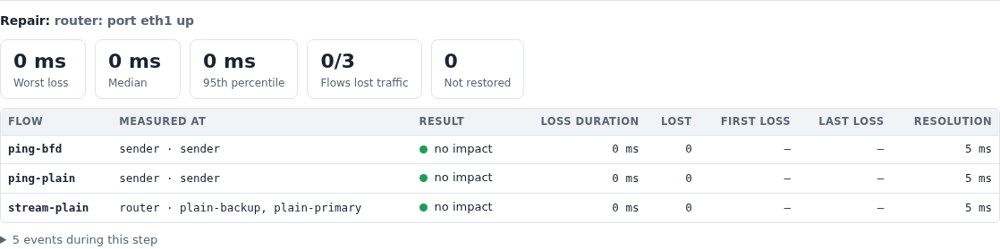

# Link failure convergence

How much traffic does a link failure cost, and how much does BFD save?
Here a failure hits two IS-IS routers at once, one with BFD and one
without, so a single [convergence test](../flows.md#convergence-tests)
gives both answers side by side.

What it shows:

- a convergence test from the Flows page: the failure, the repair, and
  the loss duration of each flow;
- an echo flow and a one-way flow measuring the same outage independently;
- what the routers did during the failure, on the same timeline;
- a one-way flow followed as its traffic moves from one device to another.

The lab is in [`examples/convergence`](../../examples/convergence).

## Topology

<picture>
  <source media="(prefers-color-scheme: dark)" srcset="../images/examples/convergence-topology-dark.svg">
  
</picture>

`router` carries two emulated IS-IS routers on both of its links, on
separate VLANs: `router-bfd` (VLAN 10) runs BFD on its primary link and
`router-plain` (VLAN 20) has only IS-IS hellos, with a 3 s hold time. Each
has a loopback, and the sender has flows to both.

> **Why this is a hard failure:** containerlab's default link to an SR-SIM
> is a stitch that doesn't carry link state
> ([more](../configuration.md)). When `router`'s `eth1` goes down, the SR
> sees nothing, and keeps sending into the link until BFD or the hold timer
> notices. This is the failure that loses traffic: think of a fault in a
> transport network between the two ends.

To deploy it, add `license: <file>` to the `sr1` node in
[`convergence.clab.yml`](../../examples/convergence/convergence.clab.yml), then:

```sh
cd examples/convergence && containerlab deploy -t convergence.clab.yml
```

Give it a couple of minutes after the SR-SIM is up: traffic has moved to
the primary links once `clabgenctl --lab convergence -s router received`
lists `bfd-primary` and `plain-primary` with a rate.

## The router

[`sr1.partial.txt`](../../examples/convergence/sr1.partial.txt) puts both
VLANs of each port in IS-IS. The metrics that pick the SR's path are on the
SR's own interfaces, and only `bfd-primary` has BFD:

```
/configure router "Base" interface "bfd-primary" ipv4 bfd admin-state enable
/configure router "Base" interface "bfd-primary" ipv4 bfd transmit-interval 100
/configure router "Base" interface "bfd-primary" ipv4 bfd receive 100
/configure router "Base" interface "bfd-primary" ipv4 bfd multiplier 3
/configure router "Base" isis 0 interface "bfd-primary" bfd-liveness ipv4 include-bfd-tlv true
/configure router "Base" isis 0 interface "bfd-backup" level 2 metric 20
/configure router "Base" isis 0 interface "plain-backup" level 2 metric 20
```

## The routers and the traffic

[`router.yml`](../../examples/convergence/router.yml) has the two IS-IS
routers and [`sender.yml`](../../examples/convergence/sender.yml) the
flows, at 200 packets a second each, so a loss duration is good to 5 ms.
(SR-SIM starts dropping above a few hundred packets a second.)

<!-- tab: IS-IS, UI -->
<picture>
  <source media="(prefers-color-scheme: dark)" srcset="../images/examples/convergence-form-isis-dark.png">
  
</picture>
<!-- tab: IS-IS, YAML -->
```yaml
devices:
  - {name: bfd-primary, port: eth1, vlans: [{vid: 10}], addresses: [10.0.10.2/30], gateway4: 10.0.10.1}
  - {name: bfd-backup, port: eth2, vlans: [{vid: 10}], addresses: [10.0.11.2/30], gateway4: 10.0.11.1}
protocols:
  - name: isis-bfd
    type: isis
    device: bfd-primary
    config:
      system_id: 0000.0000.0010
      hostname: router-bfd
      level: L2
      areas: ["49.0001"]
      metric: 10
      hello_interval: 1
      hello_multiplier: 3
      bfd: {enabled: true, min_tx_ms: 100, min_rx_ms: 100}
      interfaces: [{device: bfd-backup, metric: 20, bfd: false}]
      loopbacks: [192.0.2.10/32]
```
<!-- tab: Flow, UI -->
<picture>
  <source media="(prefers-color-scheme: dark)" srcset="../images/examples/convergence-form-flow-dark.png">
  
</picture>
<!-- tab: Flow, YAML -->
```yaml
devices:
  - {name: sender, port: eth1, addresses: [10.0.1.2/24], gateway4: 10.0.1.1}
protocols:
  - name: ping-plain
    type: icmp
    device: sender
    config: {destination: 192.0.2.20, rate: 200, auto_start: true}
  - name: stream-plain
    type: udp
    device: sender
    config: {destination: 192.0.2.20, dst_port: 5001, rate: 200, auto_start: true}
```
<!-- /tabs -->

## Running the test

On the **Flows** page, **Convergence test** covers the flows listed. Here
the failure is `eth1` going down on `router`, and the repair is it coming
back. **Clean for** is 20 s, so that the repair's measurement stays open
until traffic has moved back to the primary links.

<picture>
  <source media="(prefers-color-scheme: dark)" srcset="../images/examples/convergence-form-test-dark.png">
  
</picture>

<picture>
  <source media="(prefers-color-scheme: dark)" srcset="../images/examples/convergence-actions-dark.webp">
  
</picture>

The same from the CLI (each command runs in a shell, so it can be anything
you can script), and from Python:

```sh
export CLABGEN_LAB=convergence
clabgenctl convergence --settle 20s \
  --trigger 'clabgenctl -s router port down eth1' \
  --restore 'clabgenctl -s router port up eth1'
```
```python
lab = Lab.from_docker("convergence")
with lab.convergence() as failure:
    lab["router"].port_down("eth1")
failure.assert_restored(max_ms=5000)
print(failure["ping-bfd"].loss_ms, failure["ping-plain"].loss_ms)
```

## What it measured

<picture>
  <source media="(prefers-color-scheme: dark)" srcset="../images/examples/convergence-failure-dark.png">
  
</picture>

Over several runs of this lab:

| Flow | Loss duration | What ended it |
|---|---|---|
| `ping-bfd` | about 1.3 s, every run | BFD: clabgen's side saw it go down about 300 ms after the failure, and the rest is the SR rerouting |
| `ping-plain`, `stream-plain` | 2.3 to 3.8 s | The 3 s hold timer, and where it had got to when the link failed |

Things to read from it:

- **Two flows agree.** `ping-plain` is measured by its sender, from
  missing replies, and `stream-plain` by the device that receives it, from
  gaps in its sequence numbers. They run through the same path and give the
  same loss to within a few milliseconds, which is a good sign the number
  is real.
- **The receiver followed the traffic.** `stream-plain` was received on
  `plain-primary`, then on `plain-backup`. The result counts only the time
  neither of them got it, not what each missed while the other had it.
- **The timeline shows why.** The BFD session going down and the adjacency
  dropping sit on the same time axis as the loss. Hover over a bar or an
  event for the details. Later events, such as a hold timer expiring long
  after traffic recovered, are in the list below the table.

<picture>
  <source media="(prefers-color-scheme: dark)" srcset="../images/examples/convergence-repair-dark.png">
  
</picture>

The repair lost nothing: the SR only moves traffic back once the primary
link is working again, so it makes before it breaks. Measure it anyway,
since a repair that drops traffic is a bug worth catching.

> **These numbers are SR-SIM's:** they show how the configuration behaves
> and let you compare one setup with another. They aren't what a hardware
> router would do.

In a CI job, `assert_restored(max_ms=…)` fails the test past a limit. Flows
can also have [checks](../flows.md#passfail-checks), which cover a flow's whole
run rather than one failure.
