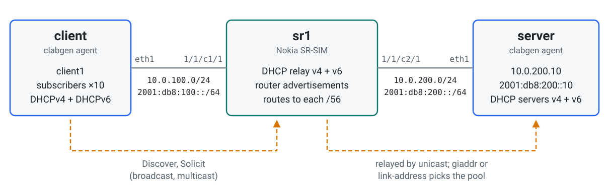
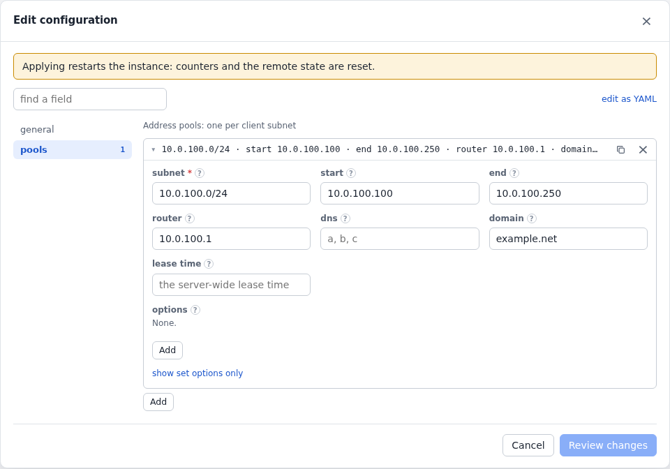
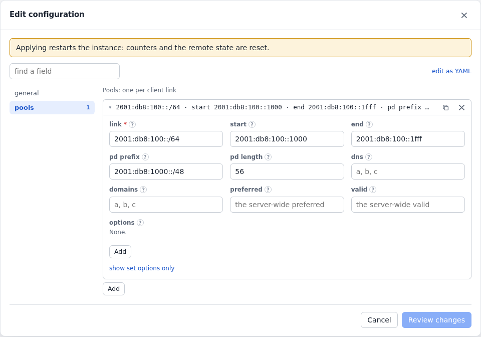
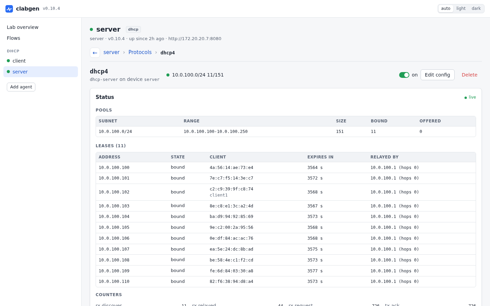
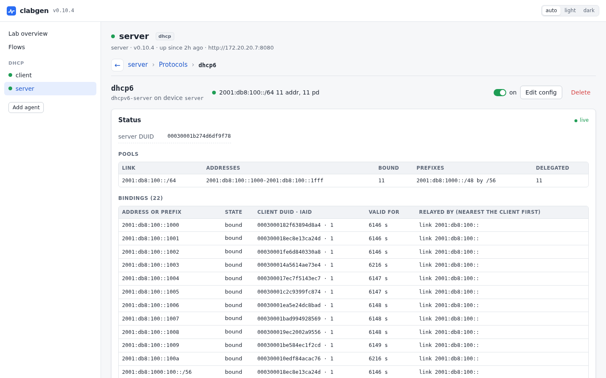
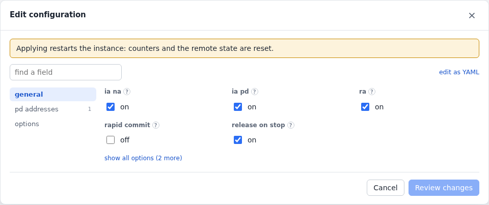
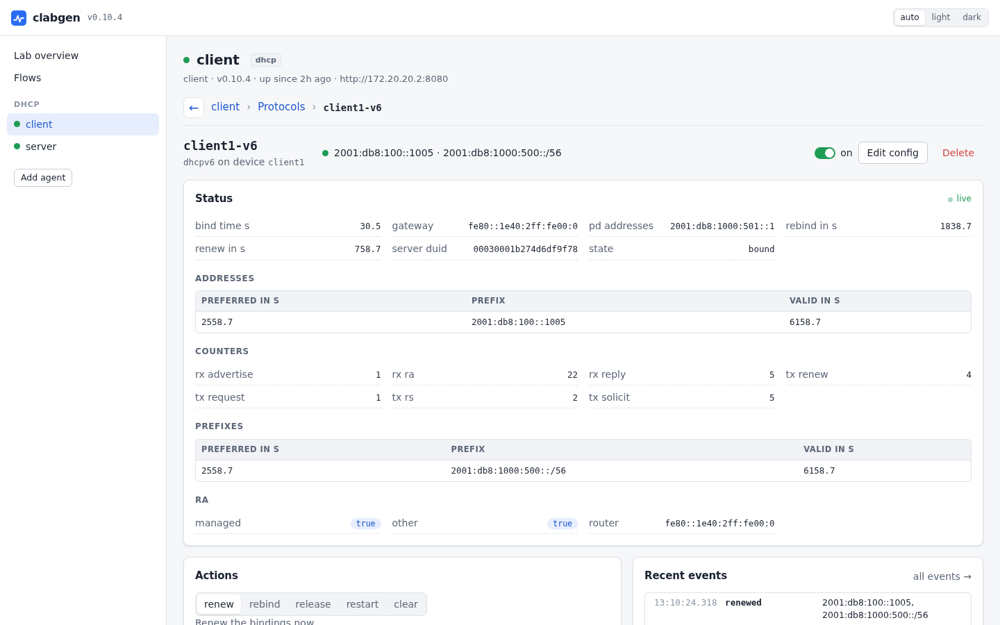
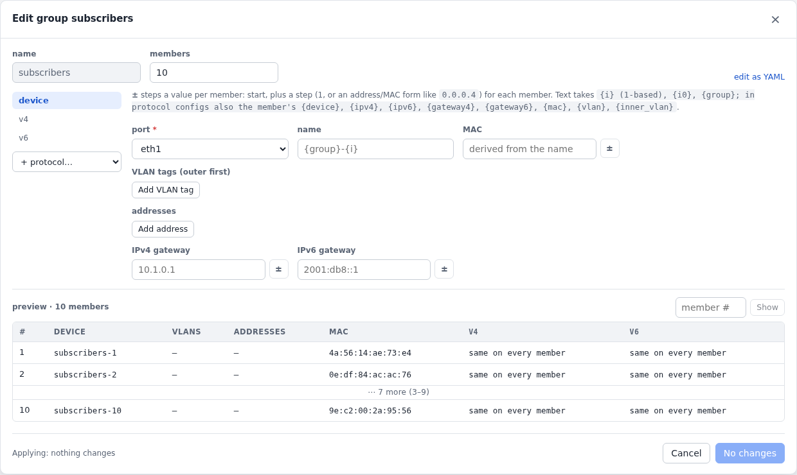
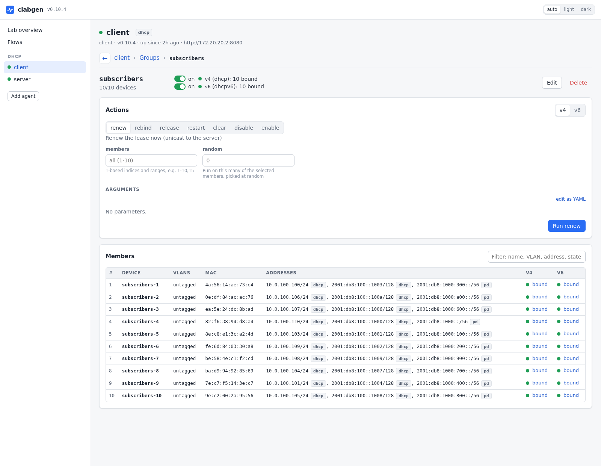

# DHCP subscribers

Subscribers lease IPv4 and IPv6 addresses, and a delegated IPv6 prefix,
through a router that relays DHCP to a server in the network. Here
clabgen plays both ends: the subscribers and the server. The router
under test is a Nokia SR-SIM.

What it shows:

- a DHCPv4 and a DHCPv6 client on one subscriber, with prefix delegation;
- a DHCP server picking the pool from the relay's address;
- a [device group](../device-groups.md) of ten subscribers, so you can
  see at a glance whether every one got its address and prefix;
- the router installing a route to each delegated prefix, checked with a
  ping from the server to a host inside one.

The lab is in [`examples/dhcp`](../../examples/dhcp).

## Topology

<picture>
  <source media="(prefers-color-scheme: dark)" srcset="../images/examples/dhcp-topology-dark.svg">
  
</picture>

> **Two agents, for clarity:** the clients and the server don't need an
> agent each. One clabgen node with two ports (`eth1` toward the
> subscriber interface, `eth2` toward the network) could run all of it.
> They're split here so each side's configuration and UI stand on their
> own.

To deploy it, add `license: <file>` to the `sr1` node in
[`dhcp.clab.yml`](../../examples/dhcp/dhcp.clab.yml), then:

```sh
cd examples/dhcp && containerlab deploy -t dhcp.clab.yml
```

The clients start at once and keep trying while the SR-SIM boots, backing
off as the RFCs say (DHCPv4 up to 64 s between tries, DHCPv6 up to
120 s). Give them a couple of minutes after the router is up.

## The router

[`sr1.partial.txt`](../../examples/dhcp/sr1.partial.txt) gives the
SR-SIM a subscriber interface and a network interface:

```
/configure router "Base" interface "to-server" port 1/1/c2/1
/configure router "Base" interface "to-server" ipv4 primary address 10.0.200.1 prefix-length 24
/configure router "Base" interface "to-server" ipv6 address 2001:db8:200::1 prefix-length 64
/configure service ies "subscribers" admin-state enable service-id 100 customer "1"
/configure service ies "subscribers" interface "subscribers" admin-state enable
/configure service ies "subscribers" interface "subscribers" sap 1/1/c1/1
/configure service ies "subscribers" interface "subscribers" ipv4 primary address 10.0.100.1 prefix-length 24
/configure service ies "subscribers" interface "subscribers" ipv4 dhcp admin-state enable server [10.0.200.10] gi-address 10.0.100.1
/configure service ies "subscribers" interface "subscribers" ipv6 address 2001:db8:100::1 prefix-length 64
/configure service ies "subscribers" interface "subscribers" ipv6 dhcp6 relay admin-state enable source-address 2001:db8:100::1 server ["2001:db8:200::10"]
/configure service ies "subscribers" interface "subscribers" ipv6 dhcp6 relay lease-populate max-nbr-of-leases 1000 route-populate pd
/configure router "Base" ipv6 router-advertisement interface "subscribers" admin-state enable
/configure router "Base" ipv6 router-advertisement interface "subscribers" managed-configuration true
/configure router "Base" ipv6 router-advertisement interface "subscribers" other-stateful-configuration true
```

- **DHCPv4 relay**: requests go to the server with `giaddr` 10.0.100.1,
  which picks the server's pool.
- **DHCPv6 relay**: requests go to the server in a Relay-forward whose
  link-address (2001:db8:100::, the interface's subnet) picks the pool.
  `route-populate pd` installs a route to each delegated prefix, toward
  the subscriber that holds it.
- **Router advertisements** give the subscribers their IPv6 gateway
  (DHCPv6 doesn't). The managed and other flags tell them to use DHCPv6.
  The SR doesn't advertise the link's /64 here, so each leased address
  stays a /128.

## The server

[`server.yml`](../../examples/dhcp/server.yml) is one device with static
addresses and a gateway back to the router, running a
[DHCPv4 and a DHCPv6 server](../dhcp.md#servers). In the UI, each
server's Edit config has its pools:

<!-- tab: UI -->
<picture>
  <source media="(prefers-color-scheme: dark)" srcset="../images/examples/dhcp-form-server4-dark.png">
  
</picture>
<picture>
  <source media="(prefers-color-scheme: dark)" srcset="../images/examples/dhcp-form-server6-dark.png">
  
</picture>
<!-- tab: YAML -->
```yaml
devices:
  - name: server
    port: eth1
    addresses: [10.0.200.10/24, 2001:db8:200::10/64]
    gateway4: 10.0.200.1
    gateway6: 2001:db8:200::1
protocols:
  - name: dhcp4
    type: dhcp-server
    device: server
    config:
      lease_time: 3600
      pools:
        # Picked by the relay's gateway address (gi-address 10.0.100.1).
        - {subnet: 10.0.100.0/24, start: 10.0.100.100, end: 10.0.100.250, router: 10.0.100.1, domain: example.net}
  - name: dhcp6
    type: dhcpv6-server
    device: server
    config:
      preferred: 3600
      valid: 7200
      pools:
        # Picked by the relay's link-address (in 2001:db8:100::/64); a /56 each
        # out of 2001:db8:1000::/48.
        - {link: 2001:db8:100::/64, start: "2001:db8:100::1000", end: "2001:db8:100::1fff",
           pd_prefix: 2001:db8:1000::/48, pd_length: 56}
```
<!-- /tabs -->

Each server's page shows its pools and lists its leases, with the relay
each one came through: for DHCPv4 the `giaddr` and hop count, for DHCPv6
the relay's link and peer addresses. In a relay test that's often the
thing to check.

<!-- tab: DHCPv4 -->
<picture>
  <source media="(prefers-color-scheme: dark)" srcset="../images/examples/dhcp-server4-dark.png">
  
</picture>
<!-- tab: DHCPv6 -->
<picture>
  <source media="(prefers-color-scheme: dark)" srcset="../images/examples/dhcp-server6-dark.png">
  
</picture>
<!-- /tabs -->

## A subscriber

In [`client.yml`](../../examples/dhcp/client.yml), `client1` is a
device with no addresses: its DHCP clients lease them.

<!-- tab: UI -->
<picture>
  <source media="(prefers-color-scheme: dark)" srcset="../images/examples/dhcp-form-client-dark.png">
  
</picture>
<!-- tab: YAML -->
```yaml
devices:
  - {name: client1, port: eth1}   # no addresses: DHCP leases them
protocols:
  - name: client1-v4
    type: dhcp
    device: client1
    config: {hostname: client1}
  - name: client1-v6
    type: dhcpv6
    device: client1
    # A host in the delegated prefix (::1 in its second /64), as a CPE's LAN
    # would have: reachable only if the router routes the prefix to us.
    config: {ia_na: true, ia_pd: true, pd_addresses: [{subnet: 1, host: 1}]}
```
<!-- /tabs -->

Once bound, the leased addresses are the device's: it answers ARP, ND
and ping on them, and flows run from them. The DHCPv6 client's page
shows its address and delegated prefix with the time left on each, the
gateway it took from the router's advertisement, and the advertisement's
flags.

<picture>
  <source media="(prefers-color-scheme: dark)" srcset="../images/examples/dhcp-client-dark.png">
  
</picture>

## Many subscribers: a client group

One subscriber tests that DHCP works. A [device group](../device-groups.md)
tests it at scale: here ten more subscribers, each its own device with its
own MAC (so its own client identifier and DUID), each running both
clients:

<!-- tab: UI -->
<picture>
  <source media="(prefers-color-scheme: dark)" srcset="../images/examples/dhcp-form-group-dark.png">
  
</picture>
<!-- tab: YAML -->
```yaml
device_groups:
  - name: subscribers
    count: 10
    device: {port: eth1}
    protocols:
      - {name: v4, type: dhcp}
      - {name: v6, type: dhcpv6, config: {ia_na: true, ia_pd: true}}
```
<!-- /tabs -->

Change `count` (the group editor, or `clabgenctl group set`) to grow or
shrink it in place: members that stay keep their leases.

The group's page counts its members by state, so a glance says whether
every subscriber got an address and a prefix. The member table lists
each one's leases (tagged `dhcp`) and delegated prefix (tagged `pd`),
IPv4 first, and the filter finds a member by any of them.

<picture>
  <source media="(prefers-color-scheme: dark)" srcset="../images/examples/dhcp-group-dark.png">
  
</picture>

A group also drives its members together, which is how to test what the
router does when many subscribers come and go at once. From the group's
Actions: release the DHCPv6 leases of members 1-5 (their IPv6 address
and /56 go), then restart them (they solicit again and are bound a moment
later):

<picture>
  <source media="(prefers-color-scheme: dark)" srcset="../images/examples/dhcp-actions-dark.webp">
  
</picture>

The same from the CLI (and a DHCPv4 renewal from three members picked at
random):

```sh
clabgenctl --lab dhcp -s client group run subscribers release --protocol v6 --members 1-5
clabgenctl --lab dhcp -s client group run subscribers restart --protocol v6 --members 1-5
clabgenctl --lab dhcp -s client group run subscribers renew --protocol v4 --random 3
```

## What to check

On the router, the relay's counters and the routes to the delegated
prefixes (one per subscriber, eleven in all):

```
show router dhcp statistics
show router dhcp6 statistics
show router route-table ipv6 protocol dhcpv6-pd
```

From the server, a ping to the host `client1` puts in its delegated
prefix: it gets there only through the router's route to that prefix.
`client1-v6`'s page (or `clabgenctl -s client proto show client1-v6`)
shows the prefix; the host is `::1` in its second /64. For
`2001:db8:1000:500::/56`:

```sh
clabgenctl --lab dhcp -s server ping server 2001:db8:1000:501::1 -c 5
```

To see what happens when the server misbehaves, use its actions
([DHCP server actions](../dhcp.md#actions)): `forget` a lease and that
client's next renewal is refused, so it starts again; `pause` the server
and restart a few group members, and they keep trying until it answers
again.
