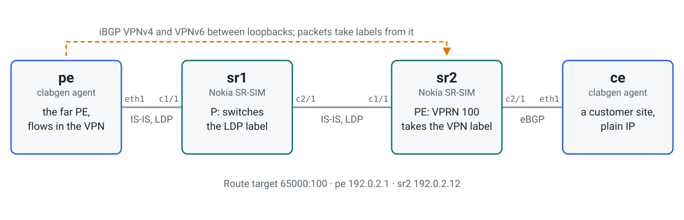
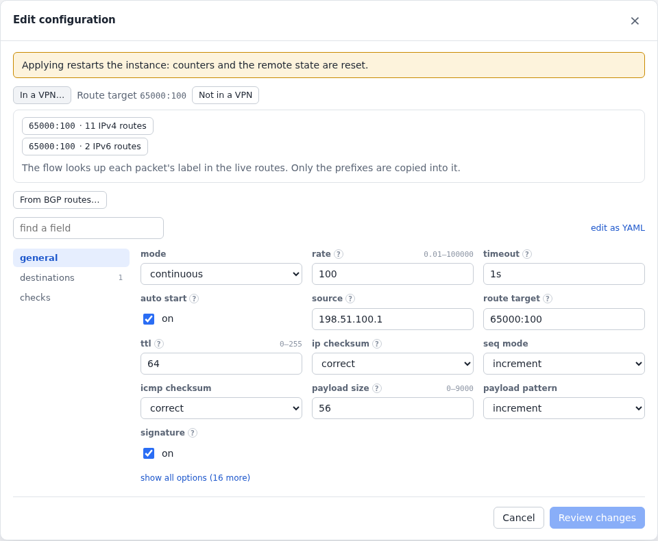
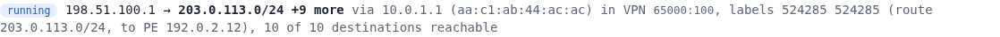
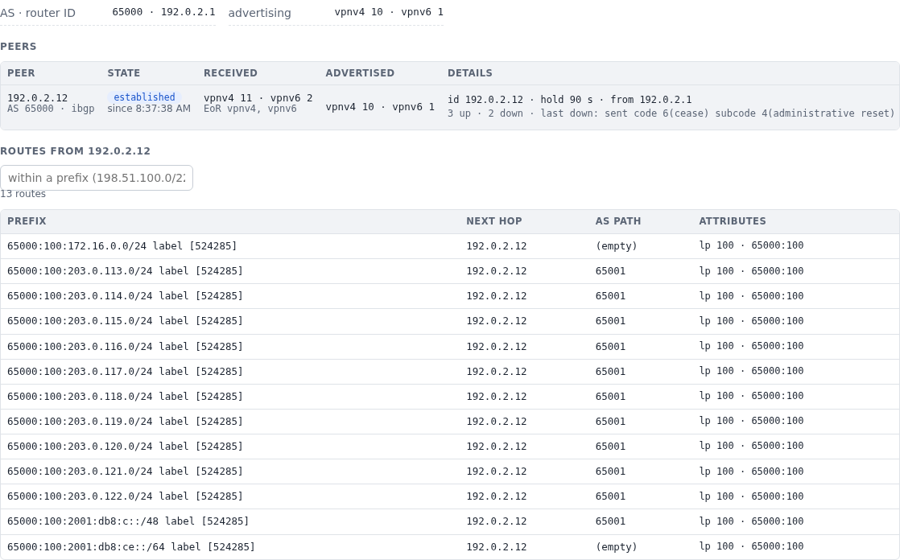
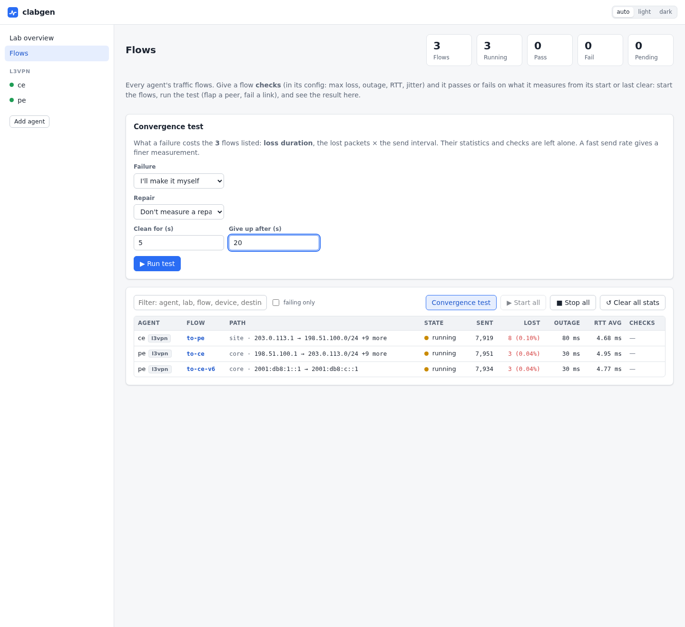

# L3VPN traffic with learned labels

clabgen is the far PE of an L3VPN through Nokia SR-SIMs. It learns VPN routes from
a real PE and sends traffic in the VPN with the labels it learned, and it's the
customer site at the other end.

What it shows:

- [flows in a VPN](../flows.md#flows-in-a-vpn), taking a label for each packet from
  the routes BGP received, with the [LDP](../ldp.md) label to the far PE on top;
- traffic from the customer site arriving at clabgen with the label clabgen
  advertised, and answers going back through the VPN;
- VPNv4 and VPNv6 (6VPE), over an IPv4 core;
- a [convergence test](../flows.md#convergence-tests) naming the one route that was
  withdrawn.

The lab is in [`examples/l3vpn`](../../examples/l3vpn).

## Topology

<picture>
  <source media="(prefers-color-scheme: dark)" srcset="../images/examples/l3vpn-topology-dark.svg">
  
</picture>

To deploy it, add `license: <file>` to the two SR nodes in
[`l3vpn.clab.yml`](../../examples/l3vpn/l3vpn.clab.yml), then:

```sh
cd examples/l3vpn && containerlab deploy -t l3vpn.clab.yml
```

Give it a few minutes after the SR-SIMs are up, until the flows are clean.

## The routers

`sr1` only switches labels: IS-IS and LDP. `sr2` is a PE with an iBGP session to
clabgen's loopback, and a VPRN whose BGP routes resolve over LDP:

```
/configure router "Base" bgp min-route-advertisement 1
/configure router "Base" bgp rapid-withdrawal true
/configure router "Base" bgp rapid-update vpn-ipv4 true
/configure router "Base" bgp rapid-update vpn-ipv6 true
/configure router "Base" bgp neighbor "192.0.2.1" group "pes"
/configure service vprn "100" bgp-ipvpn mpls route-distinguisher "65000:100"
/configure service vprn "100" bgp-ipvpn mpls vrf-target community "target:65000:100"
/configure service vprn "100" bgp-ipvpn mpls auto-bind-tunnel resolution-filter ldp true
```

> **Those timers matter here:** with SR OS's defaults a withdrawal waited its turn,
> and took 23.5 s to reach clabgen in one run. Packets kept going meanwhile, with
> the old label, and the router dropped them. That's the router's convergence, and
> a test measures it, so set the timers to what you mean to test.

## The far PE

[`pe.yml`](../../examples/l3vpn/pe.yml) has what a PE needs: IS-IS for its loopback,
LDP, and BGP with routes in the VPN. Its routes have the loopback as their next hop,
and the label traffic to them will arrive with.

`to-ce` is in the VPN. In the flow's form, **In a VPN…** lists the route targets of
the routes received. Picking one fills in the route target, the destinations, and a
source from the device's own routes in that VPN:

<!-- tab: UI -->
<picture>
  <source media="(prefers-color-scheme: dark)" srcset="../images/examples/l3vpn-flow-dark.png">
  
</picture>
<!-- tab: YAML -->
```yaml
devices:
  - {name: core, port: eth1, addresses: [10.0.1.2/30], gateway4: 10.0.1.1}
protocols:
  - name: isis
    type: isis
    device: core
    config:
      system_id: 0000.0000.0001
      hostname: pe
      level: L2
      areas: ["49.0001"]
      loopbacks: [192.0.2.1/32]
  - name: ldp
    type: ldp
    device: core
    config:
      router_id: 192.0.2.1
      fecs:
        - {prefix: 192.0.2.1/32, mode: implicit-null}
  - name: bgp
    type: bgp
    device: core
    config:
      local_as: 65000
      router_id: 192.0.2.1
      peers:
        - address: 192.0.2.12
          remote_as: 65000
          local_address: 192.0.2.1
          families: [ipv4-vpn, ipv6-vpn]
      routes:
        - prefix: 198.51.100.0/24
          count: 10
          next_hop: 192.0.2.1
          rd: "65000:1"
          label: 3001
          route_targets: ["65000:100"]
        - prefix: 2001:db8:1::/48
          next_hop: 192.0.2.1
          rd: "65000:1"
          label: 3001
          route_targets: ["65000:100"]
  - name: to-ce
    type: icmp
    device: core
    config:
      destinations: [{prefix: 203.0.113.0/24, count: 10}]
      source: 198.51.100.1
      route_target: "65000:100"
      rate: 100
      auto_start: true
  - name: to-ce-v6
    type: icmp
    device: core
    config:
      destination: 2001:db8:c::1
      source: 2001:db8:1::1
      route_target: "65000:100"
      rate: 100
      auto_start: true
```
<!-- /tabs -->

The flow's page says what its packets take now: `sr1`'s label to `sr2`, then `sr2`'s
label for the route.

<picture>
  <source media="(prefers-color-scheme: dark)" srcset="../images/examples/l3vpn-path-dark.png">
  
</picture>

The labels come from the routes on the BGP page. Click a peer to see them:

<picture>
  <source media="(prefers-color-scheme: dark)" srcset="../images/examples/l3vpn-rib-dark.png">
  
</picture>

## The customer site

[`ce.yml`](../../examples/l3vpn/ce.yml) knows nothing of labels: plain IP and eBGP
to the VPRN. Its `to-pe` flow goes to clabgen's prefixes in the VPN. `sr2` pushes the
LDP label and clabgen's 3001, and `sr1` pops the LDP label.

The `pe` agent takes the packet because of that label. Without it, its VPN prefixes
aren't answered at all, and replies go back through the VPN the same way as `to-ce`.

## Withdrawing a route

On the **Flows** page, **Convergence test** with no failure step waits for one made
elsewhere. Here the customer site withdraws a route:

```sh
clabgenctl --lab l3vpn -s ce proto run bgp withdraw 'routes=[{"prefix":"203.0.116.0/24"}]'
```

<picture>
  <source media="(prefers-color-scheme: dark)" srcset="../images/examples/l3vpn-actions-dark.webp">
  
</picture>

`to-ce` loses traffic to just that prefix, for as long as the route was gone. Its
page says `9 of 10 destinations reachable` meanwhile. The other flows aren't touched.

Other failures to try, each a `proto run` action on `pe`:

| Action | What it does here |
|---|---|
| `bgp reset peer=192.0.2.12` | The routes go and come back with the session: 7 packets lost at 100 packets a second |
| `ldp reset` | No LSP to `sr2` until the session is back: about 3 s, with `no LSP to next hop 192.0.2.12` on the flow's page |
| `bgp withdraw` of `198.51.100.0/24` | `to-pe` loses the replies from there, once `sr2` has heard |

> **These numbers are SR-SIM's:** they show how the configuration behaves, not
> what a hardware router would do.
