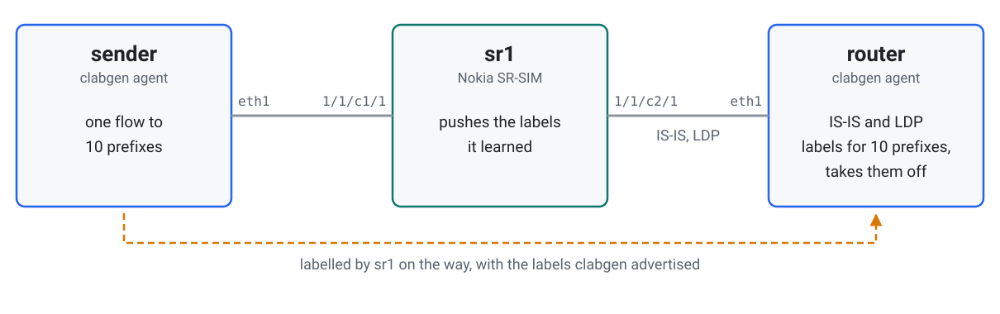
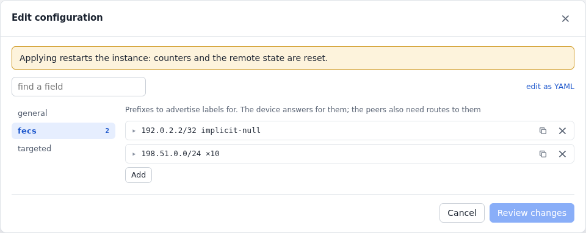
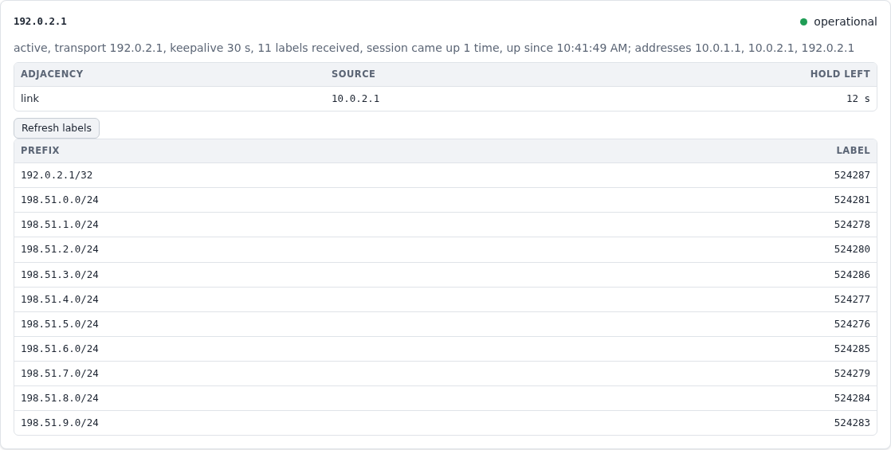
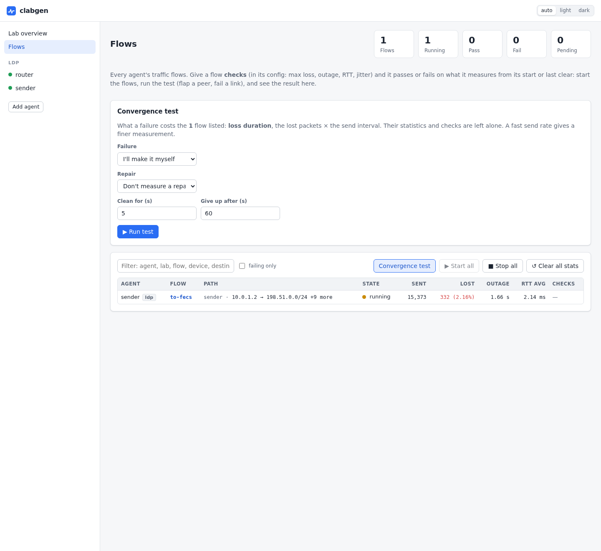

# LDP with traffic in the LSPs

A Nokia SR-SIM learns labels from a clabgen router over LDP, then pushes them
onto real traffic. This lab shows the session, the labels on the wire, and what
happens to traffic when labels and sessions go away.

What it shows:

- an [LDP](../ldp.md) session with a router, and labels both ways;
- traffic carrying the labels clabgen advertised, and clabgen taking them off;
- a [convergence test](../flows.md#convergence-tests) of withdrawing labels:
  the router falls back to plain IP.

The lab is in [`examples/ldp`](../../examples/ldp).

## Topology

<picture>
  <source media="(prefers-color-scheme: dark)" srcset="../images/examples/ldp-topology-dark.svg">
  
</picture>

To deploy it, add `license: <file>` to the `sr1` node in
[`ldp.clab.yml`](../../examples/ldp/ldp.clab.yml), then:

```sh
cd examples/ldp && containerlab deploy -t ldp.clab.yml
```

Give it a couple of minutes after the SR-SIM is up, until the session is
operational and `to-fecs` stops losing traffic.

## The router

[`sr1.partial.txt`](../../examples/ldp/sr1.partial.txt) has IS-IS and LDP on
the link to `router`. `ldp-shortcut` makes it send plain IP traffic into LDP
tunnels; without it, the labels are learned and only tunnels use them:

```
/configure router "Base" ldp interface-parameters interface "to-router" ipv4 admin-state enable
/configure router "Base" ldp ldp-shortcut ipv4 true
```

## The clabgen router

[`router.yml`](../../examples/ldp/router.yml) runs IS-IS, which gives the SR
routes to the loopback and the prefixes, and LDP, which gives it labels for them.

<!-- tab: UI -->
<picture>
  <source media="(prefers-color-scheme: dark)" srcset="../images/examples/ldp-form-dark.png">
  
</picture>
<!-- tab: YAML -->
```yaml
devices:
  - {name: core, port: eth1, addresses: [10.0.2.2/30], gateway4: 10.0.2.1}
protocols:
  - name: isis
    type: isis
    device: core
    config:
      system_id: 0000.0000.0002
      hostname: router
      level: L2
      areas: ["49.0001"]
      loopbacks: [192.0.2.2/32]
      prefixes: [{prefix: 198.51.0.0/24, count: 10}]
  - name: ldp
    type: ldp
    device: core
    config:
      router_id: 192.0.2.2
      fecs:
        - {prefix: 192.0.2.2/32, mode: implicit-null}
        - {prefix: 198.51.0.0/24, count: 10}
```
<!-- /tabs -->

The instance's page shows the session, its hello adjacency, and the labels
received:

<picture>
  <source media="(prefers-color-scheme: dark)" srcset="../images/examples/ldp-status-dark.png">
  
</picture>

## Labels on the wire

[`sender.yml`](../../examples/ldp/sender.yml) has one flow to all ten prefixes.
A capture on `router` shows each with the label clabgen gave its prefix, and the
replies going back as plain IP:

```sh
clabgenctl --lab ldp -s router capture --ethertype 0x8847 -c 3
```
```
eth1 In  aa:c1:ab:44:98:97 > 42:1b:58:6b:e6:af, MPLS 100000, IPv4 10.0.1.2 > 198.51.0.1, ICMP type 8 code 0, 102 bytes
eth1 In  aa:c1:ab:44:98:97 > 42:1b:58:6b:e6:af, MPLS 100001, IPv4 10.0.1.2 > 198.51.1.1, ICMP type 8 code 0, 102 bytes
eth1 In  aa:c1:ab:44:98:97 > 42:1b:58:6b:e6:af, MPLS 100002, IPv4 10.0.1.2 > 198.51.2.1, ICMP type 8 code 0, 102 bytes
```

## Taking labels away

On the **Flows** page, **Convergence test** withdraws two labels (`ldp`'s
`withdraw` action) and advertises them again:

<picture>
  <source media="(prefers-color-scheme: dark)" srcset="../images/examples/ldp-actions-dark.webp">
  
</picture>

The router still has IS-IS routes to those prefixes, so it falls back to plain
IP. A label withdraw costs next to nothing, and a capture shows those two
prefixes arriving unlabelled until the labels return, with new values.

The same from the CLI:

```sh
export CLABGEN_LAB=ldp
withdrawn='[{"prefix":"198.51.3.0/24","count":2}]'
clabgenctl convergence to-fecs --settle 5s \
  --trigger "clabgenctl -s router proto run ldp withdraw fecs='$withdrawn'" \
  --restore "clabgenctl -s router proto run ldp advertise fecs='$withdrawn'"
```

Other failures to try, each a `proto run ldp` action:

| Action | What it does here |
|---|---|
| `reset` | The session ends and comes back. The router drops the labels and falls back to IP |
| `flap seconds=30 mode=silent` | Longer than the hold time (15 s), so the router's timers end the session |
| `flap seconds=8 mode=silent` | Shorter than the hold time, so the session survives and nothing is lost |

> **These numbers are SR-SIM's:** they show how the configuration behaves, not
> what a hardware router would do.
