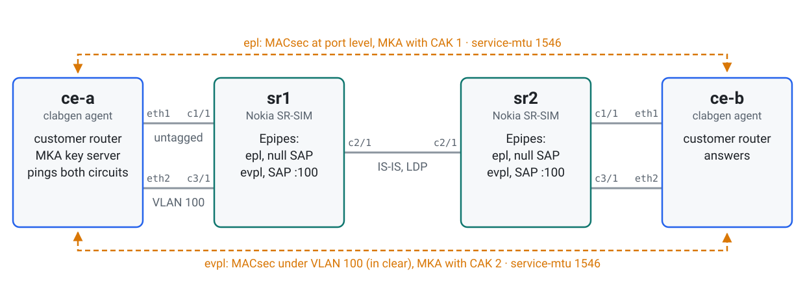
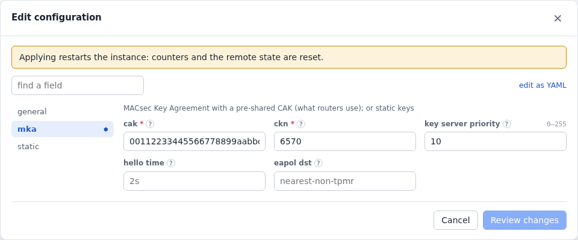
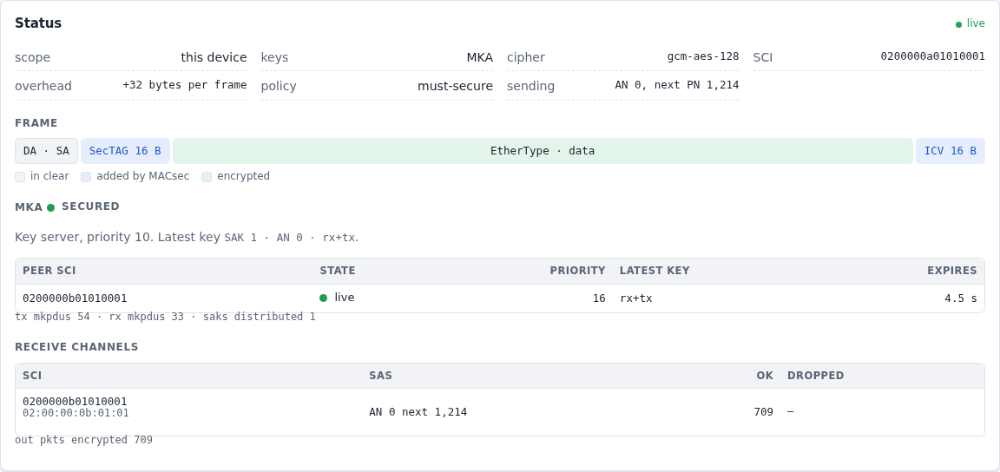
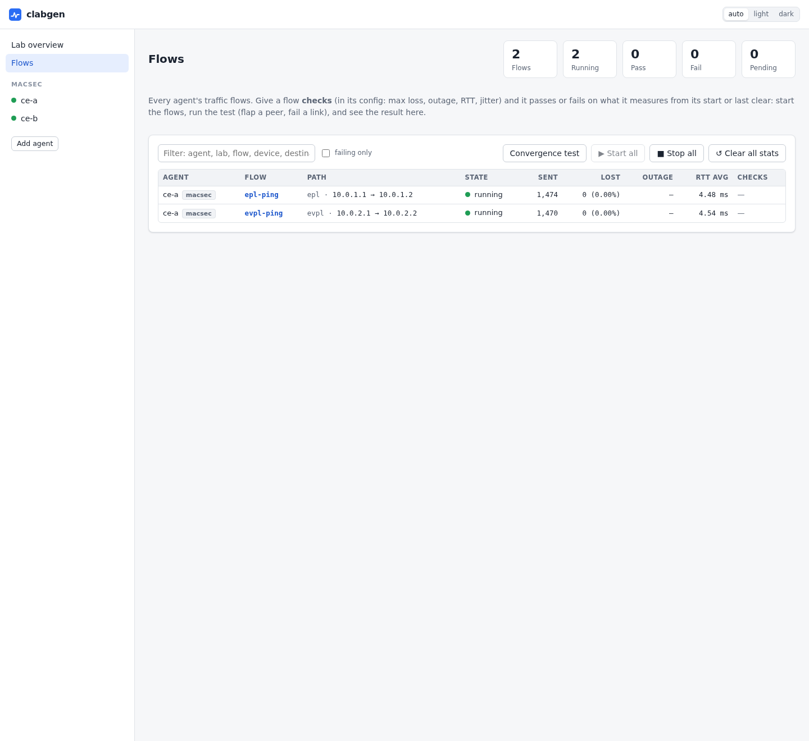

# MACsec through Epipes

Two clabgen agents are customer routers running MACsec to each other across a
provider's circuits: two Epipes between Nokia SR-SIMs. The routers carry the
MACsec frames and the MKA key exchange without being part of either.

What it shows:

- [MACsec](../macsec.md) at the port level over a port-based Epipe, and under
  VLAN 100 over a VLAN-based one, each keyed by MKA with its own CAK;
- what a provider's circuit needs for that: room for 32 more bytes in every
  frame, and the MKA exchange let through;
- what it looks like when the circuit drops the MKA exchange, and when its MTU
  is a byte short.

The lab is in [`examples/macsec`](../../examples/macsec).

## Topology

<picture>
  <source media="(prefers-color-scheme: dark)" srcset="../images/examples/macsec-topology-dark.svg">
  
</picture>

To deploy it, add `license: <file>` to the two SR nodes in
[`macsec.clab.yml`](../../examples/macsec/macsec.clab.yml), then:

```sh
cd examples/macsec && containerlab deploy -t macsec.clab.yml
```

Give it a couple of minutes after the SR-SIMs are up, until both circuits are
secured.

## The routers

Each SR-SIM has two Epipes over an LDP SDP to the other. `epl` is port-based:
its SAP is the whole access port (null encapsulation). `evpl` is VLAN 100 on a
dot1q port. What makes them carry MACsec:

```
/configure port 1/1/c1/1 ethernet encap-type null
/configure port 1/1/c1/1 ethernet mtu 1546
/configure port 1/1/c1/1 ethernet dot1x tunneling true
/configure service epipe "epl" service-mtu 1546
/configure service epipe "epl" sap 1/1/c1/1 admin-state enable

/configure port 1/1/c3/1 ethernet encap-type dot1q
/configure port 1/1/c3/1 ethernet mtu 1550
/configure service epipe "evpl" service-mtu 1546
/configure service epipe "evpl" sap 1/1/c3/1:100 admin-state enable
```

- **`dot1x tunneling true`:** MKA is EAPOL (ethertype 0x888E) to
  01:80:C2:00:00:03. SR OS takes untagged EAPOL at the port and drops it, so on
  a null SAP the key exchange never crosses, though encrypted frames would. On
  dot1q and QinQ ports it tunnels tagged EAPOL already, so `evpl` needs nothing.
- **1546:** MACsec adds 32 bytes, so a 1500-byte IP packet, a 1514-byte frame,
  is 1546 on the circuit. `service-mtu` doesn't count the VLAN tag the SAP
  strips; the dot1q port's MTU does, so it's 4 bytes more. The defaults (1514)
  would leave the customer an IP MTU of 1468.

## The customer routers

Each agent has a device per circuit and a `macsec` instance on each:
`epl-macsec` at the port level (an untagged device), `evpl-macsec` on the VLAN
100 device, which keeps its tag in front of the SecTAG for the SAP to match. Each
circuit has its own CAK, and `ce-a` is the key server with the lower priority.
`ce-a` pings `ce-b` over both, with full-size packets.

<!-- tab: UI -->
<picture>
  <source media="(prefers-color-scheme: dark)" srcset="../images/examples/macsec-form-dark.png">
  
</picture>
<!-- tab: YAML -->
```yaml
devices:
  - {name: epl, port: eth1, mac: "02:00:00:0a:01:01", addresses: [10.0.1.1/24]}
  - {name: evpl, port: eth2, mac: "02:00:00:0a:02:01", vlans: [{vid: 100}], addresses: [10.0.2.1/24]}
protocols:
  - name: epl-macsec
    type: macsec
    device: epl
    config:
      mka:
        cak: "00112233445566778899aabbccddeeff"
        ckn: "6570"
        key_server_priority: 10
  - name: evpl-macsec
    type: macsec
    device: evpl
    config:
      mka:
        cak: "ffeeddccbbaa99887766554433221100"
        ckn: "657670"
        key_server_priority: 10
  - name: epl-ping
    type: icmp
    device: epl
    config: {destination: 10.0.1.2, rate: 20, payload_size: 1472, auto_start: true}
  - name: evpl-ping
    type: icmp
    device: evpl
    config: {destination: 10.0.2.2, rate: 20, payload_size: 1472, auto_start: true}
```
<!-- /tabs -->

The instance's page shows the frame it sends, the MKA session (the peer, the
key server, the key in use) and what each receive channel took or dropped:

<picture>
  <source media="(prefers-color-scheme: dark)" srcset="../images/examples/macsec-status-dark.png">
  
</picture>

On `evpl-macsec`, VLAN 100 is in front of the SecTAG:

<picture>
  <source media="(prefers-color-scheme: dark)" srcset="../images/examples/macsec-frame-vlan-dark.png">
  
</picture>

## When the circuit drops the key exchange

Turning EAPOL tunneling off on `sr1`'s `epl` port is what a provider's default
does:

```
/configure port 1/1/c1/1 ethernet dot1x tunneling false
```

<picture>
  <source media="(prefers-color-scheme: dark)" srcset="../images/examples/macsec-actions-dark.webp">
  
</picture>

`ce-b` stops hearing `ce-a` and, three hellos later, drops the session and its
keys. `ce-a` still hears `ce-b`, but `ce-b` no longer lists it, so it drops the
session too: both ends are unsecured, and `must-secure` sends nothing. The
other circuit doesn't notice. With tunneling back, they key again within a few
seconds.

Other things to try:

| Change | What happens here |
|---|---|
| `service-mtu 1545` and port `mtu 1545` on `epl` | MKA stays secured (its frames are small) but every full-size ping is lost: the circuit looks up and drops the biggest frames |
| `clabgenctl --lab macsec -s ce-a proto run evpl-macsec rekey` | A new key on both ends; the pings lose nothing |
| `proto run epl-macsec pause-mka` on `ce-b` | `ce-a` times the session out after 6 s, then the same as above |

> **These numbers are SR-SIM's:** they show how the configuration behaves, not
> what a hardware router would do.
