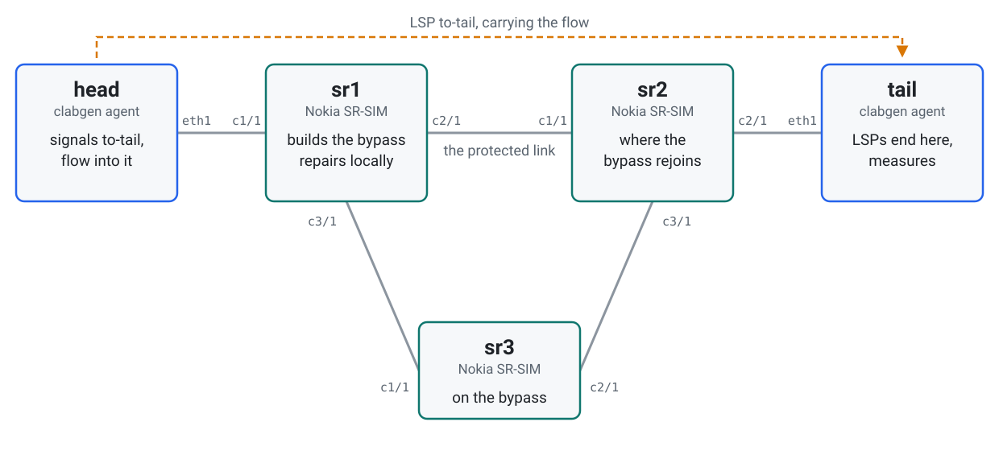
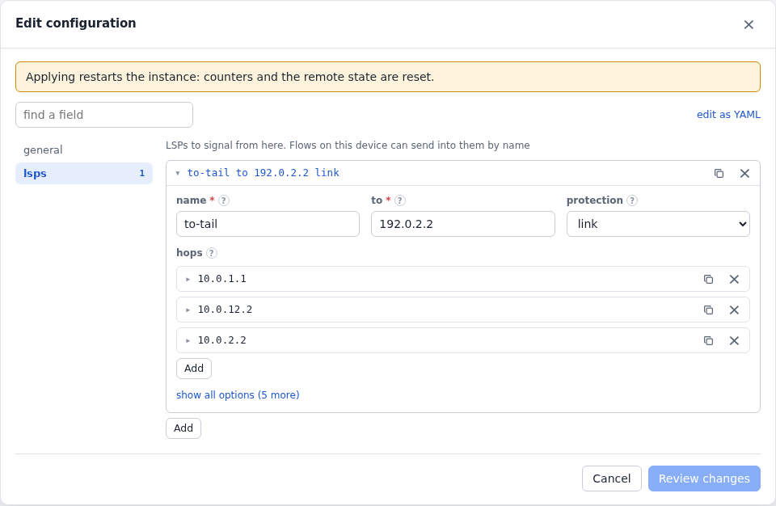
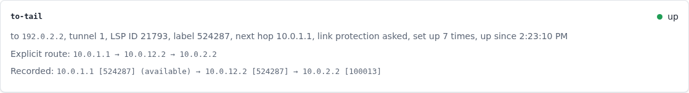
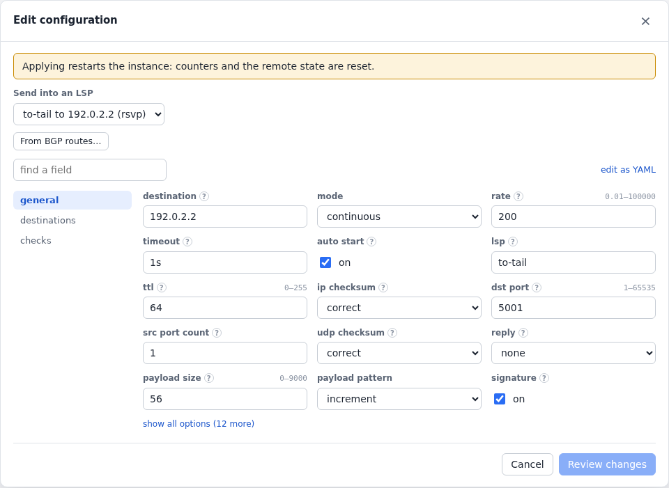
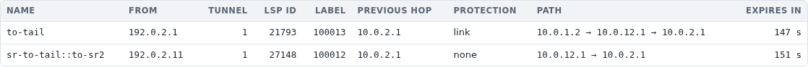
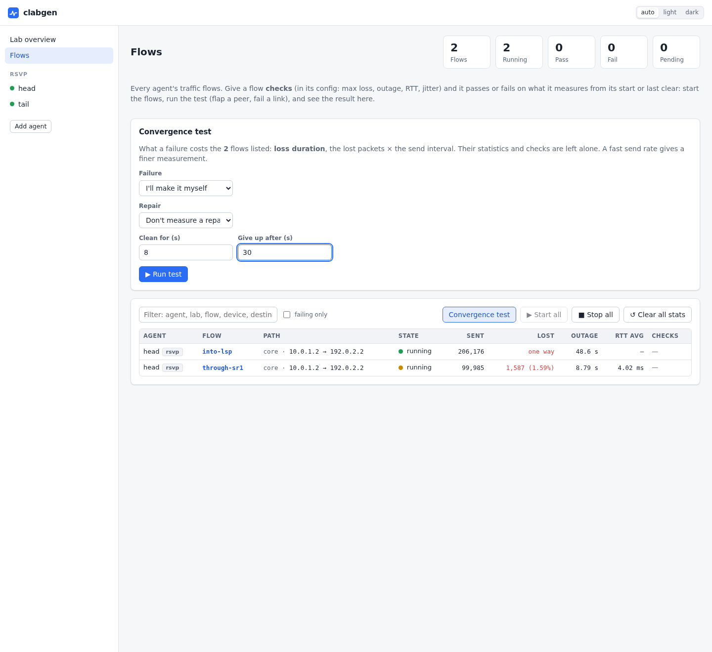

# RSVP-TE fast reroute

clabgen signals an LSP through Nokia SR-SIMs, sends traffic into it, and measures
at the far end what a link failure costs, with and without fast reroute.

What it shows:

- [RSVP-TE](../rsvp.md) from clabgen, with the path the routers recorded;
- a [flow sending into the LSP](../flows.md#flows-into-lsps), and clabgen taking
  the label off at the tail;
- a router's own LSP ending at clabgen;
- a [convergence test](../flows.md#convergence-tests) of the protected link.

The lab is in [`examples/rsvp`](../../examples/rsvp).

## Topology

<picture>
  <source media="(prefers-color-scheme: dark)" srcset="../images/examples/rsvp-topology-dark.svg">
  
</picture>

To deploy it, add `license: <file>` to the three SR nodes in
[`rsvp.clab.yml`](../../examples/rsvp/rsvp.clab.yml), then:

```sh
cd examples/rsvp && containerlab deploy -t rsvp.clab.yml
```

Give it a couple of minutes after the SR-SIMs are up, until `to-tail` is up.

## The routers

Each has IS-IS with traffic engineering, and MPLS and RSVP on its links. That is
all it takes for `sr1` to build a bypass around the link to `sr2` when an LSP asks
for protection: it goes through `sr3`, whose links cost more. `sr1` also has an LSP
of its own to the tail, and an IGP shortcut that sends traffic into it:

```
/configure router "Base" mpls lsp "sr-to-tail" to 192.0.2.2
/configure router "Base" mpls lsp "sr-to-tail" primary "to-sr2"
/configure router "Base" isis 0 igp-shortcut admin-state enable
```

> **What these routers ask of a head:** with `protection` set, they refuse an LSP
> unless every hop is strict (routing problem, bad explicit route). Without it,
> hops can be loose or left out, unless an IGP shortcut has tunnelled the route
> to the tail, as here.

## The head

[`head.yml`](../../examples/rsvp/head.yml) signals `to-tail` with link protection:

<!-- tab: UI -->
<picture>
  <source media="(prefers-color-scheme: dark)" srcset="../images/examples/rsvp-form-dark.png">
  
</picture>
<!-- tab: YAML -->
```yaml
devices:
  - {name: core, port: eth1, addresses: [10.0.1.2/30], gateway4: 10.0.1.1}
protocols:
  - name: isis
    type: isis
    device: core
    config:
      system_id: 0000.0000.0001
      hostname: head
      level: L2
      areas: ["49.0001"]
      loopbacks: [192.0.2.1/32]
  - name: rsvp
    type: rsvp
    device: core
    config:
      router_id: 192.0.2.1
      lsps:
        - name: to-tail
          to: 192.0.2.2
          protection: link
          hops:
            - {address: 10.0.1.1}
            - {address: 10.0.12.2}
            - {address: 10.0.2.2}
```
<!-- /tabs -->

Its page shows the label from `sr1`, the recorded path with each router's label,
and the protection `sr1` has available:

<picture>
  <source media="(prefers-color-scheme: dark)" srcset="../images/examples/rsvp-head-dark.png">
  
</picture>

## Flows

`into-lsp` sends into the LSP: pick it in the flow's form, under
**Send into an LSP**.

<!-- tab: UI -->
<picture>
  <source media="(prefers-color-scheme: dark)" srcset="../images/examples/rsvp-flow-dark.png">
  
</picture>
<!-- tab: YAML -->
```yaml
  - name: into-lsp
    type: udp
    device: core
    config:
      destination: 192.0.2.2
      lsp: to-tail
      dst_port: 5001
      rate: 200
      auto_start: true
  - name: through-sr1
    type: icmp
    device: core
    config:
      destination: 192.0.2.2
      rate: 100
      auto_start: true
```
<!-- /tabs -->

`into-lsp` is one way, measured at the tail. An echo would measure the replies too,
and they come back as plain IP over the same link, waiting for IS-IS. `through-sr1`
is routed as usual, and it's `sr1` that pushes a label, of its own LSP.

## The tail

[`tail.yml`](../../examples/rsvp/tail.yml) has just the router ID. Both LSPs end
here, and a capture shows the labels it gave them:

<picture>
  <source media="(prefers-color-scheme: dark)" srcset="../images/examples/rsvp-tail-dark.png">
  
</picture>

```sh
clabgenctl --lab rsvp -s tail capture --ethertype 0x8847 -c 2
```

```
eth1 In  aa:c1:ab:50:33:c9 > 46:af:ba:72:5e:a7, MPLS 100000, IPv4 10.0.1.2 > 192.0.2.2, UDP 53961 > 5001, 102 bytes
eth1 In  aa:c1:ab:50:33:c9 > 46:af:ba:72:5e:a7, MPLS 100001, IPv4 10.0.1.2 > 192.0.2.2, ICMP type 8 code 0, 102 bytes
```

## Failing the protected link

On the **Flows** page, **Convergence test** with no failure step waits for one made
elsewhere. Here it's the SR1 side of the link to `sr2`:

```
/configure port 1/1/c2/1 admin-state disable
```

<picture>
  <source media="(prefers-color-scheme: dark)" srcset="../images/examples/rsvp-actions-dark.webp">
  
</picture>

`sr1` repairs the LSP as soon as it sees the link go, and the head hears about it
from a notification: the timeline has the repair where the loss begins. Traffic in
the LSP lost at most 1 packet at 200 packets a second, in every run.

`through-sr1` loses about a second, in LSP or not. Its replies come back as plain
IP over the same link, and wait for IS-IS. That's why `into-lsp` is one way.

Without protection the LSP goes down with the link, and comes back on another path
once the head tries again: about 5 s, which is its `retry_interval`. To try that,
take `protection` and `hops` off `to-tail`, and `sr1`'s IGP shortcut off too: with
the shortcut, its route to the tail goes into a tunnel, which an LSP can't follow.

The LSP stays on the bypass when the link comes back, and the page says it's been
repaired. To put it back, run the `resignal` action.

Other failures to try, each a `proto run rsvp` action:

| On | Action | What it does here |
|---|---|---|
| `tail` | `relabel` | New labels: no traffic lost |
| `tail` | `tear lsp=to-tail seconds=15` | `into-lsp` loses exactly those 15 s; the label comes back when they're over |
| `tail` | `tear lsp=sr-to-tail::to-sr2` | `sr1` takes down its LSP, loses about a second, falls back to IS-IS and signals it again |
| `tail` | `flap seconds=30 mode=silent` | `sr2`'s hellos go unanswered, and it ends the LSPs through it after about 8 s. They come back within about 30 s of the flap's end |
| `head` | `resignal lsp=to-tail` | Make before break: a new LSP ID, no traffic lost |

> **These numbers are SR-SIM's:** they show how the configuration behaves, not
> what a hardware router would do.
