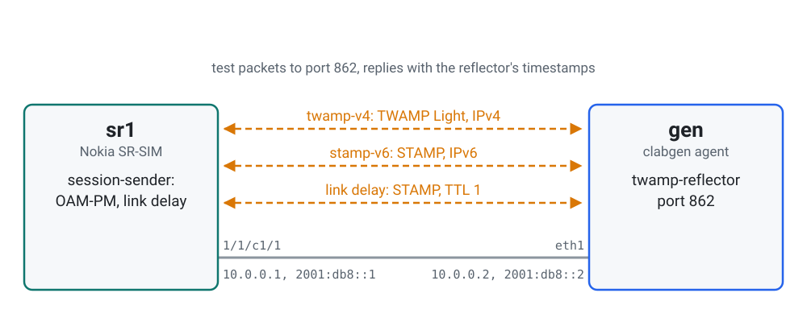
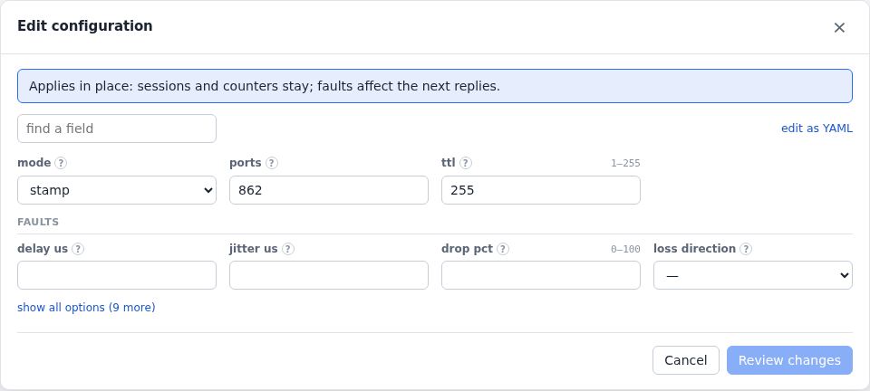
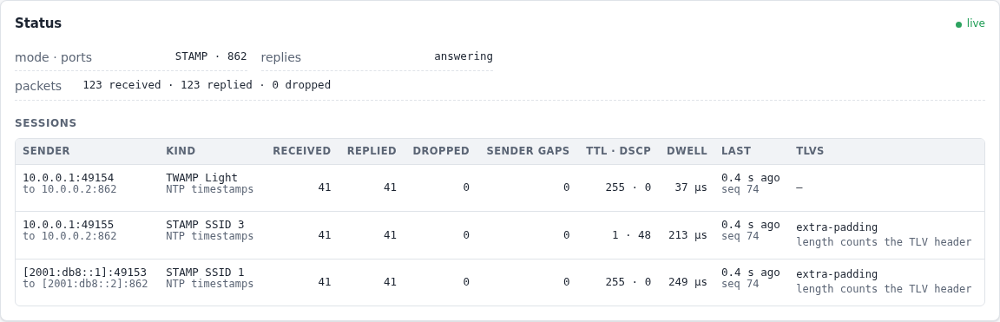
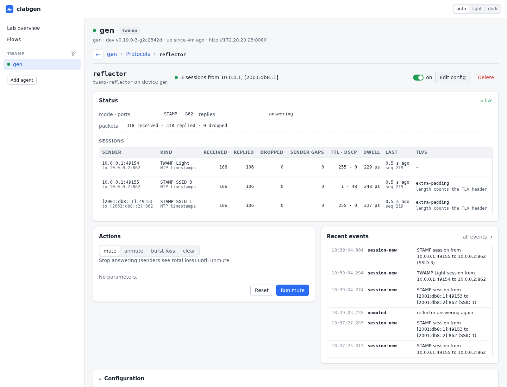

# TWAMP Light and STAMP with an SR-SIM

A Nokia SR-SIM measures delay and loss to a clabgen agent: two OAM-PM
sessions, one TWAMP Light over IPv4 and one STAMP over IPv6, and the link
delay measurement of its interface. clabgen is the
[reflector](../twamp.md) at the far end, standing in for another router.

What it shows:

- what the router sends and what clabgen makes of it: three sessions, their
  kind, SSID, the TTL and DSCP they arrive with, their TLVs;
- the router's threshold alarms set off from the far end: replies held to
  raise delay, replies lost in a burst or for a while to raise loss and
  unavailability, and a wrong clock that skews one-way delay.

The lab is in [`examples/twamp`](../../examples/twamp).

## Topology

<picture>
  <source media="(prefers-color-scheme: dark)" srcset="../images/examples/twamp-topology-dark.svg">
  
</picture>

To deploy it, add `license: <file>` to sr1 in
[`twamp.clab.yml`](../../examples/twamp/twamp.clab.yml), then:

```sh
cd examples/twamp && containerlab deploy -t twamp.clab.yml
```

The sessions start as soon as the SR-SIM is up.

## The router

Two OAM-PM sessions to gen, port 862, a packet a second. `twamp-v4` records
delay and loss in 1-minute intervals and raises threshold alarms (TCAs) on
them; bin group 2 counts round trips over 5 ms:

```
/configure oam-pm bin-group 2 bin-type fd bin 1 lower-bound 5000
/configure oam-pm bin-group 2 bin-type fd delay-event round-trip lowest-bin 1 raise-threshold 3 clear-threshold 0

/configure oam-pm session "twamp-v4" bin-group 2
/configure oam-pm session "twamp-v4" measurement-interval 1-min threshold-cross-alerts admin-state enable delay-events true loss-events true
/configure oam-pm session "twamp-v4" ip router-instance "Base" source 10.0.0.1 destination 10.0.0.2 destination-udp-port 862
/configure oam-pm session "twamp-v4" ip twamp-light test-id 1 interval 1000 record-stats delay-and-loss
/configure oam-pm session "twamp-v4" ip twamp-light loss flr-threshold 50
/configure oam-pm session "twamp-v4" ip twamp-light loss-events avg-flr-event backward raise-threshold 5.0
/configure oam-pm session "twamp-v4" ip twamp-light loss-events unavailability-event backward raise-threshold 5

/configure oam-pm session "stamp-v6" ip source 2001:db8::1 destination 2001:db8::2 destination-udp-port 862
/configure oam-pm session "stamp-v6" ip twamp-light session-sender-type stamp pad-tlv-size 20
```

(and the same loss events forward). The interface measures its link delay
with STAMP every second, as it would to a neighbor router for delay-based
traffic engineering:

```
/configure test-oam link-measurement measurement-template "link-delay" interval 1
/configure test-oam link-measurement measurement-template "link-delay" twamp-light session-sender-type stamp pad-tlv-size 8
/configure router interface "to-gen" if-attribute delay dynamic link-measurement link-measurement-template "link-delay"
/configure router interface "to-gen" if-attribute delay dynamic twamp-light ipv4 source 10.0.0.1 destination 10.0.0.2 admin-state enable
```

- **`record-stats delay-and-loss`:** without it OAM-PM keeps no loss
  statistics for TWAMP Light, only delay.
- **`destination-udp-port`:** has no default; 862 is the port assigned to
  TWAMP and STAMP.

## The reflector

One device with both addresses and a `twamp-reflector`, all defaults: STAMP
mode (it answers TWAMP Light too), port 862, any sender.

<!-- tab: UI -->
<picture>
  <source media="(prefers-color-scheme: dark)" srcset="../images/examples/twamp-form-dark.png">
  
</picture>
<!-- tab: YAML -->
```yaml
devices:
  - {name: gen, port: eth1, addresses: [10.0.0.2/24, "2001:db8::2/64"], gateway4: 10.0.0.1}
protocols:
  - {name: reflector, type: twamp-reflector, device: gen}
```
<!-- /tabs -->

## What to look at

### The sessions

The reflector's page lists what sr1 sends:

<picture>
  <source media="(prefers-color-scheme: dark)" srcset="../images/examples/twamp-status-dark.png">
  
</picture>

- `twamp-v4` is TWAMP Light: 14-byte packets, nothing to identify the session
  but its ports.
- `stamp-v6` is STAMP, SSID 1, with an Extra Padding TLV of `pad-tlv-size`.
- The link measurement is the session with TTL 1 and DSCP 48 (network control):
  STAMP, SSID 3.
- SR OS counts a TLV's header in its length field (RFC 8972 counts only the
  value): `pad-tlv-size 20` is a TLV of length 20 with 16 bytes after its
  header. The reflector takes it that way and says so.

On sr1, `show oam-pm statistics session "twamp-v4" twamp-light meas-interval raw`
has the delays both ways and the round trip; on this host about 1 ms round
trip, most of it the SR-SIM's own path. `show test-oam link-measurement
interface "to-gen" detail` has the link delay samples.

### Setting off the router's alarms

Each fault changes the next replies, with the reflector and its sessions
running on. From the reflector's Actions, or its config:

<picture>
  <source media="(prefers-color-scheme: dark)" srcset="../images/examples/twamp-actions-dark.webp">
  
</picture>

| On the reflector | On sr1 |
|---|---|
| `delay_us: 8000` | Round trips over 5 ms: within seconds, `TCA raised for session "twamp-v4" … Threshold type delay, direction round-trip, bin lower bound (us) 5000`. The forward delay grows by 8 ms, the backward stays. |
| `burst-loss count=5`, or `drop_pct: 20` | Lost replies, backward: when the interval ends, `TCA raised … Threshold type loss-avg-flr, direction backward … operational value 18.333%`. |
| `mute` for 12 s | Five seconds unavailable backward: `TCA raised … Threshold type loss-unavail, direction backward`. Those seconds don't count in the loss ratio. |
| `loss_direction: forward` with any of these | The same losses, forward. |
| `clock_offset_ms: 100` | Forward delay 100 ms more, backward clamped at 0, round trip unchanged: what a far end whose clock is off does to one-way figures. |

The loss lands backward because the reflector's sequence number moves on for
a reply it drops, as if it was sent and lost on the way back; sr1 compares
the two sequence numbers to tell the directions apart.
