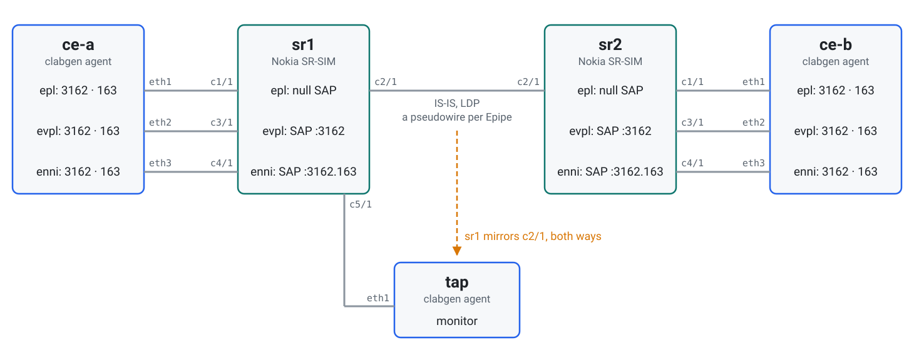
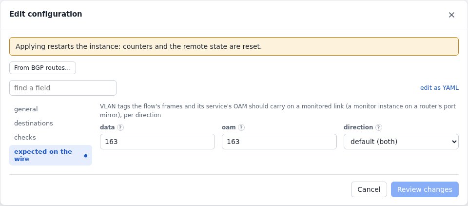
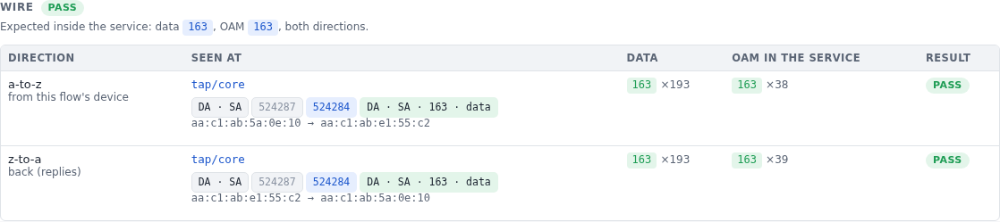
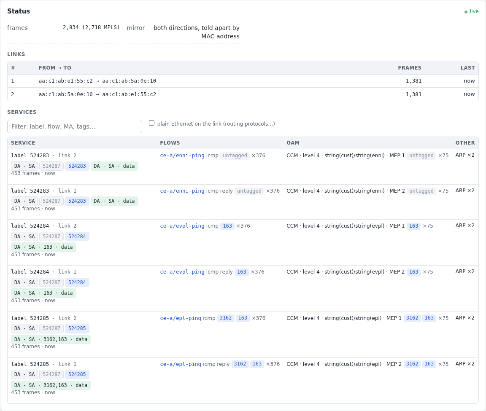
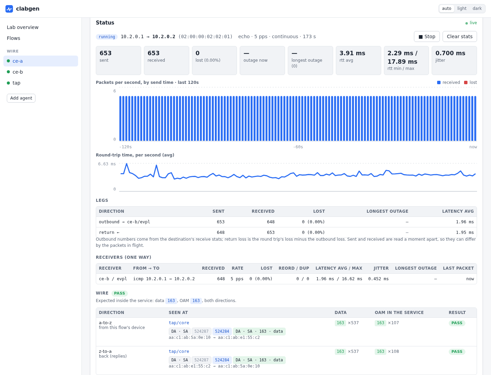

# VLAN tags inside Epipes

What a customer's frames look like inside a provider's pseudowires depends on
the SAP: a null SAP carries every tag, a dot1q SAP takes its tag off, a QinQ
SAP both. This lab checks it on the wire: a Nokia SR-SIM mirrors its core link
to a clabgen monitor, and each customer flow says which tags it expects there,
for its own frames and for its service's CCMs, both ways.

What it shows:

- a [monitor](../wire.md) on a router's port mirror: MPLS frames taken apart,
  per service label and direction, with the flows and OAM inside;
- flows that pass or fail on the tags they and their CCMs carry in the core;
- what a wrong SAP looks like: the wrong tags one way, nothing back.

The lab is in [`examples/wire`](../../examples/wire).

## Topology

<picture>
  <source media="(prefers-color-scheme: dark)" srcset="../images/examples/wire-topology-dark.svg">
  
</picture>

To deploy it, add `license: <file>` to the two SR nodes in
[`wire.clab.yml`](../../examples/wire/wire.clab.yml), then:

```sh
cd examples/wire && containerlab deploy -t wire.clab.yml
```

The pings start answering a couple of minutes after the SR-SIMs are up.

## The routers

Each SR-SIM has three Epipes to the other over an LDP SDP, one per kind of
SAP. Every customer device sends two tags, 3162 outside and 163 inside, so
what's left of them in the core is the SAP's doing:

```
/configure service epipe "epl"  sap 1/1/c1/1           # null:  3162,163 in the core
/configure service epipe "evpl" sap 1/1/c3/1:3162      # dot1q: 163
/configure service epipe "enni" sap 1/1/c4/1:3162.163  # QinQ:  untagged
```

sr1 mirrors its core port, both directions, to the port wired to `tap`:

```
/configure port 1/1/c5/1 ethernet mode access
/configure port 1/1/c5/1 ethernet mtu 9212
/configure mirror mirror-dest "core" service-id 900
/configure mirror mirror-dest "core" sap 1/1/c5/1
/configure mirror mirror-source "core" port 1/1/c2/1 ingress true
/configure mirror mirror-source "core" port 1/1/c2/1 egress true
```

## The customer and the monitor

`ce-a` and `ce-b` have a device per Epipe, each with a CFM MEP (level 4, an MA
per service). `ce-a` pings `ce-b` over each, and each ping says what it
expects in the core: its own frames (`data`) and its service's CCMs (`oam`).
`tap` has one device on the mirror port and a `monitor` on it.

<!-- tab: UI -->
<picture>
  <source media="(prefers-color-scheme: dark)" srcset="../images/examples/wire-form-dark.png">
  
</picture>
<!-- tab: YAML -->
```yaml
# ce-a.yml (ce-b.yml has the same devices and MEPs, and answers the pings)
devices:
  - {name: epl,  port: eth1, mac: "02:00:00:01:01:01", vlans: [{vid: 3162}, {vid: 163}], addresses: [10.1.0.1/24]}
  - {name: evpl, port: eth2, mac: "02:00:00:01:02:01", vlans: [{vid: 3162}, {vid: 163}], addresses: [10.2.0.1/24]}
  - {name: enni, port: eth3, mac: "02:00:00:01:03:01", vlans: [{vid: 3162}, {vid: 163}], addresses: [10.3.0.1/24]}
protocols:
  - {name: evpl-mep, type: cfm-mep, device: evpl, config: {level: 4, mep_id: 1, remote_meps: [2], md_format: string, md_name: cust, ma_name: evpl}}
  - name: evpl-ping
    type: icmp
    device: evpl
    config: {destination: 10.2.0.2, rate: 5, auto_start: true, wire: {data: "163", oam: "163"}}
  # … epl (3162,163) and enni (untagged) alike

# tap.yml
devices:
  - {name: tap, port: eth1}
protocols:
  - {name: core, type: monitor, device: tap}
```
<!-- /tabs -->

The ping's page has a **Wire** section: per direction, where the monitor saw
it (the service label, and the frame's layout), the tags of its frames and of
the CCMs in the same service:

<picture>
  <source media="(prefers-color-scheme: dark)" srcset="../images/examples/wire-flow-dark.png">
  
</picture>

The monitor's page lists every service it sees: the pseudowire label each
way, the flows in it, named, and the CCMs with their MA:

<picture>
  <source media="(prefers-color-scheme: dark)" srcset="../images/examples/wire-monitor-dark.png">
  
</picture>

Or, for the whole lab (the labels are whatever the routers allocated, so
they differ from one deployment to the next):

```
$ clabgenctl --lab wire wire
FLOW            VERDICT  DIRECTION  MONITOR   LABEL   DATA            OAM
ce-a/enni-ping  pass     a-to-z     tap/core  524283  untagged ×61 ✓  untagged ×12 ✓
                         z-to-a     tap/core  524284  untagged ×61 ✓  untagged ×12 ✓
ce-a/epl-ping   pass     a-to-z     tap/core  524285  3162,163 ×62 ✓  3162,163 ×13 ✓
                         z-to-a     tap/core  524286  3162,163 ×62 ✓  3162,163 ×12 ✓
ce-a/evpl-ping  pass     a-to-z     tap/core  524284  163 ×61 ✓       163 ×12 ✓
                         z-to-a     tap/core  524285  163 ×61 ✓       163 ×13 ✓
```

## A wrong SAP

On sr1, `evpl`'s SAP becomes the default SAP of its port, which takes any tag
and keeps it:

```
/configure service epipe "evpl" sap 1/1/c3/1:* admin-state enable
```

<picture>
  <source media="(prefers-color-scheme: dark)" srcset="../images/examples/wire-actions-dark.webp">
  
</picture>

From `ce-a`, frames and CCMs now cross the core with both tags, `3162,163`,
and fail. `sr2` still pushes 3162 on what it hands `ce-b`, which gets three
tags and answers nothing: no data comes back. Its own CCMs still go the other
way with 163, as before; the monitor finds them by their MA, so that direction
shows its OAM passing and its data pending.

```
$ clabgenctl --lab wire wire evpl-ping
FLOW            VERDICT  DIRECTION  MONITOR   LABEL   DATA                       OAM
ce-a/evpl-ping  fail     a-to-z     tap/core  524284  3162,163 ×76 ✗ (want 163)  3162,163 ×15 ✗ (want 163)
                         z-to-a     tap/core  524285  none yet (want 163)        163 ×15 ✓
```

What's seen adds up until the monitor is cleared: with the SAP back, clear it
(`clabgenctl --lab wire -s tap proto run core clear`, or its page's Clear)
for a fresh verdict. Clear it before each configuration you test.

Other things to try:

| Change | What the monitor shows |
|---|---|
| `vc-type vlan` and `vlan-vc-tag 500` on both ends of `evpl`'s spoke-SDP | `500,163` both ways, data and CCMs: the pseudowire's tag in front of the customer's (and a new label: the pseudowire is signalled again) |
| `enni`'s SAP on sr1 `:3162.*` instead of `:3162.163` | `163` from `ce-a`, as with the dot1q SAP; nothing back |
| `wire: {data: "163", direction: a-to-z}` on a one-way UDP flow | checked one way only, no replies needed |

> **These labels and tags are SR-SIM's:** the configuration behaves the same
> on hardware, but check your own platform's defaults.
