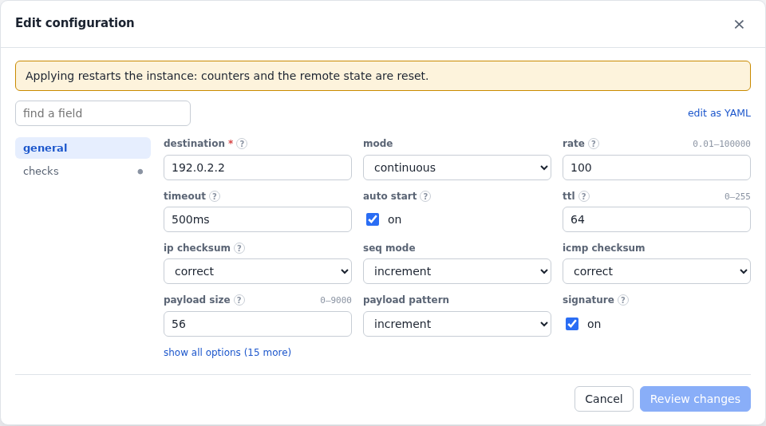
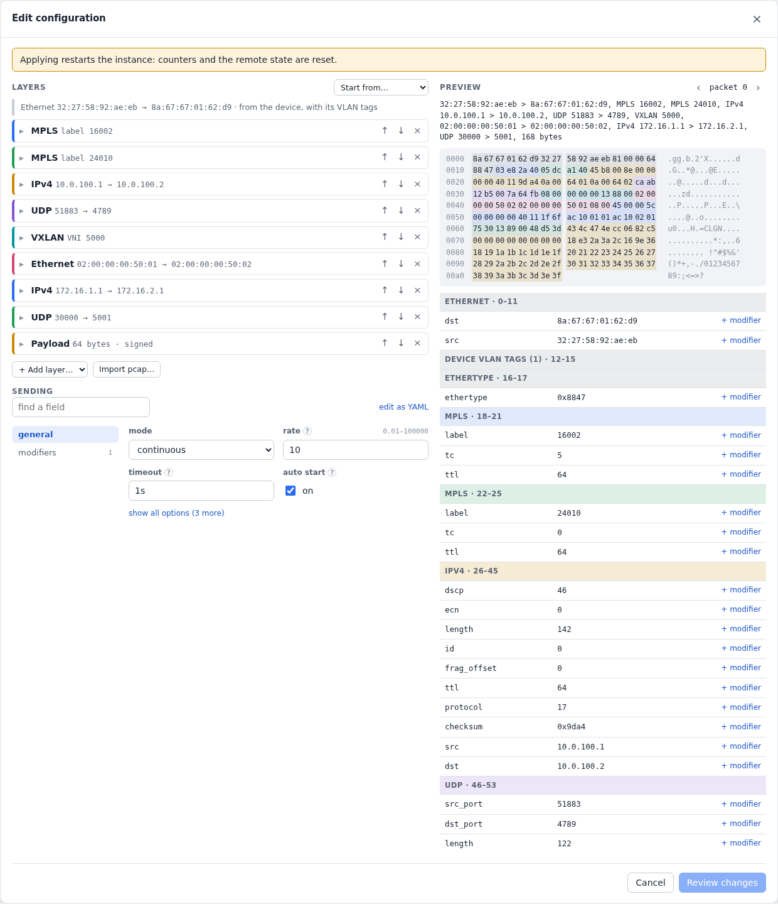

# Traffic flows

Flows are protocol instances of a traffic type. Every flow has `mode`
(`continuous`, `count` or `duration`), `rate`, `timeout` and
`auto_start`, and the `start`, `stop`, `clear` and `preview` actions.

## ICMP

<!-- tab: YAML -->
```yaml
- name: ping
    type: icmp
    device: pe
    config: {destination: 192.0.2.2, rate: 100, timeout: 500ms, auto_start: true,
             checks: {max_loss_pct: 1, max_outage_ms: 50}}
```
<!-- tab: UI -->
<picture>
  <source media="(prefers-color-scheme: dark)" srcset="images/form-ping-dark.png">
  
</picture>
<!-- /tabs -->

Every IP and ICMP field can be set: the type and code, identifier,
sequence start or a fixed sequence, TTL, DSCP/ECN, DF, IP ID, flow label
and payload pattern. Checksums can be set deliberately wrong. The
`preview` action shows the next packet as hex.

An outage is a run of consecutive lost packets times the send interval,
so a 100 pps flow measures a failover to within 10 ms.

## UDP

```yaml
  - {name: reflector, type: udp-echo, device: v401, config: {ports: [7]}}
  - name: udp-rt
    type: udp
    device: v400
    config: {destination: 10.0.41.2, reply: echo, rate: 100, src_port_count: 16, auto_start: true}
```

- `dst_port`, `src_port`, and `src_port_count` to cycle source ports and
  spread ECMP or LAG hashing.
- `udp_checksum`.
- `reply`: `none` (one way) or `echo`, answered by a `udp-echo` responder
  (or any UDP echo service) for round-trip loss and RTT.

## Measuring one way

Flows carry a signature, so any clabgen device counts the signed packets
addressed to it: loss, reordering, duplicates, latency and outages. You
see them in `clabgenctl received`, in the Traffic tab's "Received here",
and in the Receivers table on the sender's flow page. One-way latency is
meaningful because agents on one host share its clock. When an echo
flow's destination is a clabgen device, its page splits the round trip
into the outbound and return legs (loss and latency per direction).

## Raw L2 streams

An L2 stream (`type: l2`) sends Ethernet frames with no IP header, so it
tests a circuit (an Epipe, a VPLS, a bridge domain) with no addresses on
either end. Its devices need only a port, a MAC and their VLAN tags. The
payload starts with the same signature as the IP flows, so the far device
counts the stream on its own: loss, reordering, duplicates, one-way
latency and outages, with the source MACs it saw and the ethertype.

```yaml
devices:
  - {name: a, port: eth1, mac: "02:00:00:00:01:01", vlans: [{vid: 300}]}
  - {name: b, port: eth2, mac: "02:00:00:00:02:01", vlans: [{vid: 300}]}
protocols:
  - name: a-to-b
    type: l2
    device: a
    config: {dst_mac: "02:00:00:00:02:01", rate: 1000, frame_size: 1500, auto_start: true}
```

- `dst_mac`: the far device's MAC. The default is broadcast, which a VPLS
  floods. A broadcast or multicast stream reaches every device on the
  receiving port, but it is listed once among the received flows, under
  a standalone device rather than a group member.
- `src_mac`: the first source MAC. The default is the device's MAC.
- `src_mac_count`: cycles through this many source MACs, one per frame,
  to fill MAC tables or test MAC limits.
- `ethertype`: the default is 0x88b5 (local experimental). Types that a
  switch or router would consume are refused: IP, ARP, CFM, LLDP, slow
  protocols (LACP, OAM), PTP and VLAN tags.
- `frame_size`: 60–9018 bytes without the FCS, VLAN tags included. 60 is
  a minimum 64-byte frame on the wire.
- `vlan_pcp`: the PCP on every VLAN tag.
- `payload_pattern`: the fill after the signature.

`reply: echo` measures the round trip. An `l2-echo` responder on the far
device answers stream frames of its ethertypes. Each answer goes back to
the frame's source MAC and keeps the request's PCP. The stream then has
loss, outage, RTT and jitter, and [checks](#passfail-checks) work as for
the IP flows. The responder answers every MAC the stream cycles through,
so echo works with `src_mac_count` too.

```yaml
  - {name: echo, type: l2-echo, device: b, config: {ethertypes: [0x88b5]}}
  - name: a-b-rt
    type: l2
    device: a
    config: {dst_mac: "02:00:00:00:02:01", reply: echo, rate: 100, auto_start: true,
             checks: {max_loss_pct: 0.1, max_outage_ms: 50}}
```

## Packet builder

A packet flow (`type: packet`) sends frames you build layer by layer, with
every field settable, or replays a capture. Layers go outermost first; the
device adds its MAC and VLAN tags to the first Ethernet header, written or
not. Lengths, checksums, next-protocol numbers and ethertypes are filled
in unless set (set them wrong on purpose to test how a device copes).

VXLAN over an MPLS label stack, with the inner UDP source port counting
up:

<!-- tab: YAML -->
```yaml
- name: crafted
    type: packet
    device: v100
    config:
      layers:
        - mpls: {label: 16002, tc: 5}
        - mpls: {label: 24010}
        - ipv4: {src: 10.0.100.1, dst: 10.0.100.2, dscp: 46}
        - udp: {dst_port: 4789}
        - vxlan: {vni: 5000}
        - ethernet: {src: "02:00:00:00:50:01", dst: "02:00:00:00:50:02"}
        - ipv4: {src: 172.16.1.1, dst: 172.16.2.1}
        - udp: {src_port: 30000, dst_port: 5001}
        - payload: {size: 64, pattern: increment}
      modifiers:
        - {field: "udp[2].src_port", mode: increment, start: "30000", count: 64}
      rate: 10
      auto_start: true
```
<!-- tab: UI -->
<picture>
  <source media="(prefers-color-scheme: dark)" srcset="images/form-packet-dark.png">
  
</picture>
<!-- /tabs -->

- **Layers**: `ethernet`, `vlan` (a tag inside the device's own), `mpls`,
  `arp`, `ipv4`, `ipv6`, `udp`, `tcp`, `icmp`, `icmpv6`, `vxlan`, `raw`
  (hex bytes) and `payload`. An `ethernet` layer after VXLAN or MPLS is an
  inner frame. Each layer's fields are in the schema (`clabgenctl types
  packet`). Unset source addresses are the device's, and an unset first
  destination MAC is the next hop of the first IP destination (ARP/ND).
- **Modifiers** change a field from packet to packet:
    - A field is named `layer.field` (`ipv4.src`, `ethernet.src`,
      `vlan.vid`), or `layer[n].field` for the nth layer of a kind
      (`vlan[2].vid`).
    - `increment` and `decrement` count from `start` by `step`, `count`
      values before wrapping. `random` picks among `count` values from
      `start`, or the whole range. `list` cycles through `values`.
    - `repeat` holds each value for that many packets.
    - Addresses step in their own form (`step: 0.0.1.0`) or as numbers.
      Checksums are redone after each change.
- **Measuring**: the payload starts with the signature (on by default), so
  clabgen receivers count the stream one way, like the other flows. A
  packet flow doesn't wait for replies.
- **Replaying a capture**: `pcap: {data: <base64 of a pcap or pcapng>}`
  replays its frames in order, at the flow's rate:
    - `frames` picks some (`1-10,15`).
    - `src_mac: keep` keeps the captured source MAC (default: the
      device's).
    - `vlans: keep` keeps the captured VLAN tags inside the device's
      (default: the device's tags replace them).
    - `clabgenctl proto add NAME --type packet --pcap FILE` fills in the
      data. A capture is at most 8 MiB and is stored in the flow's config.
- **Previewing**: `clabgenctl preview` and the UI's packet editor show the
  exact bytes, decoded by layer, for any packet index, before or after
  the flow exists.

## Pass/fail checks

`checks` give a flow a verdict: limits on what it measured since it
started or was last cleared. Any limit can be left out.

```yaml
    config: {destination: 10.0.4.1, rate: 100, auto_start: true,
             checks: {max_loss_pct: 1, max_outage_ms: 50, max_rtt_avg_ms: 5, max_rtt_ms: 20, max_jitter_ms: 2}}
```

- The verdict is `pending` until something was answered or lost, then
  `pass` or `fail`.
- A failure stays until the flow's statistics are cleared. So a test is:
  clear (or start) the flows, do the thing under test (flap a peer, fail a
  link), and read the verdicts.
- Loss, outage and RTT are measured by echo flows. A one-way flow's checks
  stay `pending`, since its loss is counted at the receivers.

The Flows page shows every agent's flows with their verdicts, and starts,
stops or clears them all. `clabgenctl protocols` adds `checks=pass` or
`checks=fail (…)`, and the status has the measured value of each check.
