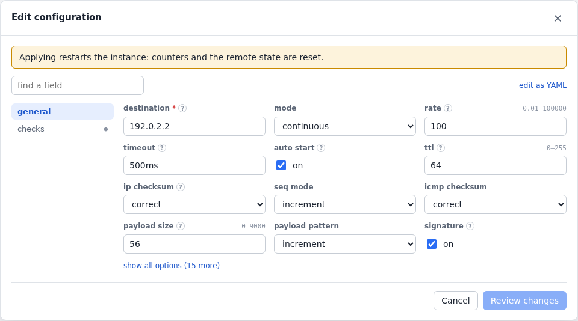
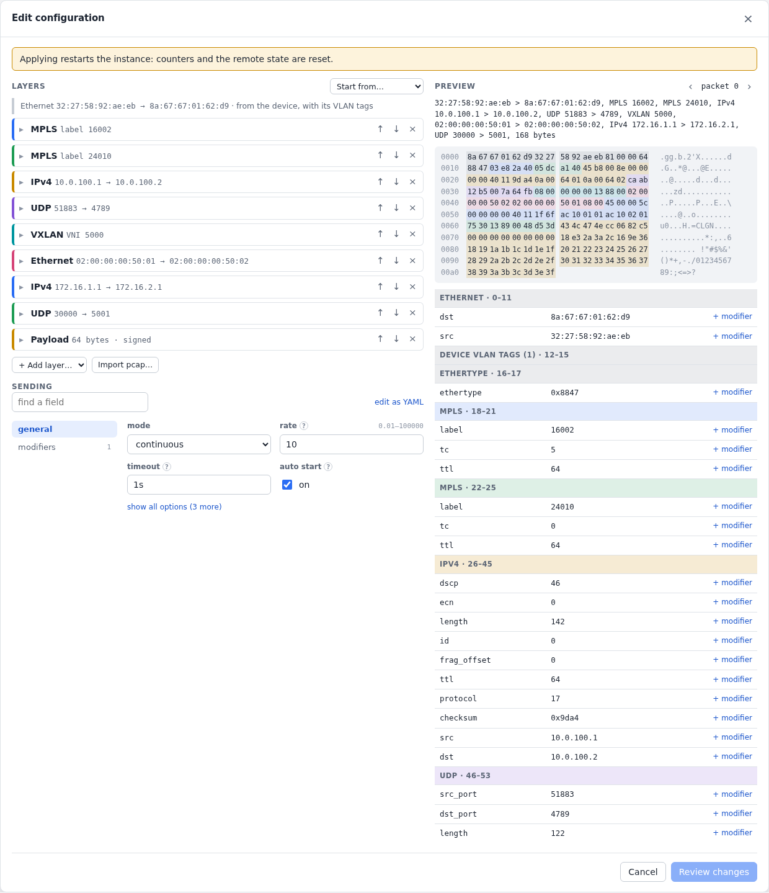

# Traffic flows

Flows are protocol instances of a traffic type. Every flow has `mode`
(`continuous`, `count` or `duration`), `rate`, `timeout`, `auto_start`
and `phase`, and the `start`, `stop`, `clear` and `preview` actions.

## ICMP

<!-- tab: YAML -->
```yaml
- name: ping
    type: icmp
    device: pe
    config: {destination: 192.0.2.2, rate: 100, timeout: 500ms, auto_start: true,
             checks: {max_loss_pct: 1, max_outage_ms: 50}}
```
<!-- tab: UI -->
<picture>
  <source media="(prefers-color-scheme: dark)" srcset="images/form-ping-dark.png">
  
</picture>
<!-- /tabs -->

Every IP and ICMP field can be set: the type and code, identifier,
sequence start or a fixed sequence, TTL, DSCP/ECN, DF, IP ID, flow label
and payload pattern. Checksums can be set deliberately wrong. The
`preview` action shows the next packet as hex.

An outage is a run of consecutive lost packets times the send interval,
so a 100 pps flow measures a failover to within 10 ms.

## UDP

```yaml
  - {name: reflector, type: udp-echo, device: v401, config: {ports: [7]}}
  - name: udp-rt
    type: udp
    device: v400
    config: {destination: 10.0.41.2, reply: echo, rate: 100, src_port_count: 16, auto_start: true}
```

- `dst_port`, `src_port`, and `src_port_count` to cycle source ports and
  spread ECMP or LAG hashing.
- `udp_checksum`.
- `reply`: `none` (one way) or `echo`, answered by a `udp-echo` responder
  (or any UDP echo service) for round-trip loss and RTT.

## Measuring one way

Flows carry a signature, so any clabgen device counts the signed packets
addressed to it: loss, reordering, duplicates, latency and outages. You
see them in `clabgenctl received`, in the Traffic tab's "Received here",
and in the Receivers table on the sender's flow page. One-way latency is
meaningful because agents on one host share its clock. When an echo
flow's destination is a clabgen device, its page splits the round trip
into the outbound and return legs (loss and latency per direction).

## Raw L2 streams

An L2 stream (`type: l2`) sends Ethernet frames with no IP header, so it
tests a circuit (an Epipe, a VPLS, a bridge domain) with no addresses on
either end. Its devices need only a port, a MAC and their VLAN tags. The
payload starts with the same signature as the IP flows, so the far device
counts the stream on its own: loss, reordering, duplicates, one-way
latency and outages, with the source MACs it saw and the ethertype.

```yaml
devices:
  - {name: a, port: eth1, mac: "02:00:00:00:01:01", vlans: [{vid: 300}]}
  - {name: b, port: eth2, mac: "02:00:00:00:02:01", vlans: [{vid: 300}]}
protocols:
  - name: a-to-b
    type: l2
    device: a
    config: {dst_mac: "02:00:00:00:02:01", rate: 1000, frame_size: 1500, auto_start: true}
```

- `dst_mac`: the far device's MAC. The default is broadcast, which a VPLS
  floods. A broadcast or multicast stream reaches every device on the
  receiving port, but it is listed once among the received flows, under
  a standalone device rather than a group member.
- `src_mac`: the first source MAC. The default is the device's MAC.
- `src_mac_count`: cycles through this many source MACs, one per frame,
  to fill MAC tables or test MAC limits.
- `ethertype`: the default is 0x88b5 (local experimental). Types that a
  switch or router would consume are refused: IP, ARP, CFM, LLDP, slow
  protocols (LACP, OAM), PTP and VLAN tags.
- `frame_size`: 60–9018 bytes without the FCS, VLAN tags included. 60 is
  a minimum 64-byte frame on the wire.
- `vlan_pcp`: the PCP on every VLAN tag.
- `payload_pattern`: the fill after the signature.

`reply: echo` measures the round trip. An `l2-echo` responder on the far
device answers stream frames of its ethertypes. Each answer goes back to
the frame's source MAC and keeps the request's PCP. The stream then has
loss, outage, RTT and jitter, and [checks](#passfail-checks) work as for
the IP flows. The responder answers every MAC the stream cycles through,
so echo works with `src_mac_count` too.

```yaml
  - {name: echo, type: l2-echo, device: b, config: {ethertypes: [0x88b5]}}
  - name: a-b-rt
    type: l2
    device: a
    config: {dst_mac: "02:00:00:00:02:01", reply: echo, rate: 100, auto_start: true,
             checks: {max_loss_pct: 0.1, max_outage_ms: 50}}
```

## Packet builder

A packet flow (`type: packet`) sends frames you build layer by layer, with
every field settable, or replays a capture. Layers go outermost first; the
device adds its MAC and VLAN tags to the first Ethernet header, written or
not. Lengths, checksums, next-protocol numbers and ethertypes are filled
in unless set (set them wrong on purpose to test how a device copes).

VXLAN over an MPLS label stack, with the inner UDP source port counting
up:

<!-- tab: YAML -->
```yaml
- name: crafted
    type: packet
    device: v100
    config:
      layers:
        - mpls: {label: 16002, tc: 5}
        - mpls: {label: 24010}
        - ipv4: {src: 10.0.100.1, dst: 10.0.100.2, dscp: 46}
        - udp: {dst_port: 4789}
        - vxlan: {vni: 5000}
        - ethernet: {src: "02:00:00:00:50:01", dst: "02:00:00:00:50:02"}
        - ipv4: {src: 172.16.1.1, dst: 172.16.2.1}
        - udp: {src_port: 30000, dst_port: 5001}
        - payload: {size: 64, pattern: increment}
      modifiers:
        - {field: "udp[2].src_port", mode: increment, start: "30000", count: 64}
      rate: 10
      auto_start: true
```
<!-- tab: UI -->
<picture>
  <source media="(prefers-color-scheme: dark)" srcset="images/form-packet-dark.png">
  
</picture>
<!-- /tabs -->

- **Layers**: `ethernet`, `vlan` (a tag inside the device's own), `mpls`,
  `arp`, `ipv4`, `ipv6`, `udp`, `tcp`, `icmp`, `icmpv6`, `vxlan`, `raw`
  (hex bytes) and `payload`. An `ethernet` layer after VXLAN or MPLS is an
  inner frame. Each layer's fields are in the schema (`clabgenctl types
  packet`). Unset source addresses are the device's, and an unset first
  destination MAC is the next hop of the first IP destination (ARP/ND).
- **Modifiers** change a field from packet to packet:
    - A field is named `layer.field` (`ipv4.src`, `ethernet.src`,
      `vlan.vid`), or `layer[n].field` for the nth layer of a kind
      (`vlan[2].vid`).
    - `increment` and `decrement` count from `start` by `step`, `count`
      values before wrapping. `random` picks among `count` values from
      `start`, or the whole range. `list` cycles through `values`.
    - `repeat` holds each value for that many packets.
    - Addresses step in their own form (`step: 0.0.1.0`) or as numbers.
      Checksums are redone after each change.
- **Measuring**: the payload starts with the signature (on by default), so
  clabgen receivers count the stream one way, like the other flows. A
  packet flow doesn't wait for replies.
- **Replaying a capture**: `pcap: {data: <base64 of a pcap or pcapng>}`
  replays its frames in order, at the flow's rate:
    - `frames` picks some (`1-10,15`).
    - `src_mac: keep` keeps the captured source MAC (default: the
      device's).
    - `vlans: keep` keeps the captured VLAN tags inside the device's
      (default: the device's tags replace them).
    - `clabgenctl proto add NAME --type packet --pcap FILE` fills in the
      data. A capture is at most 8 MiB and is stored in the flow's config.
- **Previewing**: `clabgenctl preview` and the UI's packet editor show the
  exact bytes, decoded by layer, for any packet index, before or after
  the flow exists.

## When packets go out

A flow sends one packet every interval (1 / `rate`) from its first one.
`phase` sets when the first one goes out:

- `spread` (the default): in the biggest gap between the packets of the
  agent's other running flows, every port counted. 84 flows at 1 pps that
  start together (a scenario's `auto_start`, the Flows page's Start all)
  send one packet about every 12 ms, not 84 at once every second. A flow
  waits at most one interval, and never more than a second: a 0.1 pps flow
  among 1 pps flows takes the next gap in their second.
- `now`: at once, for a test that needs the first packet without delay or
  wants flows to send together.

Spreading matters on simulated routers: their receive path may hold only a
few frames at a time, so packets that arrive together are dropped there,
before the port counts them, even though the average rate is low. The
first packets of each burst get through and the later ones don't, so loss
looks tied to whichever flows start last.

When the host stalls, a flow makes up at most 10 ms of missed packets and
skips the rest, so it doesn't send a burst either. In `count` mode it still
sends exactly `count` packets.

## Pass/fail checks

`checks` give a flow a verdict: limits on what it measured since it
started or was last cleared. Any limit can be left out.

```yaml
    config: {destination: 10.0.4.1, rate: 100, auto_start: true,
             checks: {max_loss_pct: 1, max_outage_ms: 50, max_rtt_avg_ms: 5, max_rtt_ms: 20, max_jitter_ms: 2}}
```

- The verdict is `pending` until something was answered or lost, then
  `pass` or `fail`.
- A failure stays until the flow's statistics are cleared. So a test is:
  clear (or start) the flows, do the thing under test (flap a peer, fail a
  link), and read the verdicts.
- Loss, outage and RTT are measured by echo flows. A one-way flow's checks
  stay `pending`, since its loss is counted at the receivers.

The Flows page shows every agent's flows with their verdicts, and starts,
stops or clears them all. `clabgenctl protocols` adds `checks=pass` or
`checks=fail (…)`, and the status has the measured value of each check.

## Flows into LSPs

An `icmp` or `udp` flow can send into an LSP that an [RSVP-TE](rsvp.md) instance
on its device signals, by name: `lsp: to-tail`, or **Send into an LSP** in the
flow's form. An example: [RSVP-TE fast reroute](examples/rsvp.md).

```yaml
    config:
      destination: 192.0.2.2
      lsp: to-tail
      rate: 200
```

- Each packet gets the LSP's current label and goes to its next hop, so a new
  label or path applies at once, and a tail that pops the label gets plain IP.
- **While the LSP is down, packets count as lost** and aren't sent, and the flow's
  page says why. They don't fall back to plain IP.
- IPv4 only, unless the flow is [in a VPN](#flows-in-a-vpn). `dst_mac` doesn't go
  with it.
- **Replies aren't in the LSP.** The far end sends them as plain IP, so an echo flow
  also measures the way back. To measure just the LSP, use a one-way flow, measured
  at a clabgen receiver.

## Flows in a VPN

An `icmp` or `udp` flow can send in an L3VPN: `route_target` names the VPN, or
**In a VPN…** in the flow's form picks one from the routes received. An example:
[L3VPN traffic with learned labels](examples/l3vpn.md).

```yaml
  - name: to-ce
    type: icmp
    device: core
    config:
      destinations: [{prefix: 203.0.113.0/24, count: 10}]
      source: 198.51.100.1
      route_target: "65000:100"
      rate: 100
```

- **Each packet looks up its destination** in the VPNv4 or VPNv6 routes
  [BGP](bgp.md#vpn-families) on the device received with that route target: the
  longest match, then highest local preference, shortest AS path, lowest MED. So a
  new label, a withdrawn route or a peer going down applies at once.
- **On top goes a way to the route's next hop:** the LSP named in `lsp`, else an LSP
  ending there, from [RSVP-TE](rsvp.md) if there is one and otherwise
  [LDP](ldp.md). LDP's count for a `/32` FEC from a peer on the link. A next hop on
  the device's link needs no LSP: the VPN label goes alone.
- **While there's no route or no LSP, packets count as lost** and aren't sent, and
  the flow's page says why. A label sent to a router that isn't the PE would only be
  dropped there.
- `source` is required, and should be in a prefix the far end reaches through the VPN.
  Advertise it with the same route target for replies to come back.
- IPv6 works over an IPv4 core, with the route's IPv4-mapped next hop (6VPE).
  `dst_mac` doesn't go with it.

**Receiving:** a route the device advertises with an `rd` makes its `label` the
device's. A packet arriving with it is for this device if it's to a prefix behind
that label, and only then: the same address without the label isn't answered. Echo
replies, and those of `udp-echo`, go back through the VPN, using the routes received
with the route targets of the one the packet came in on. Give each VPN its own
label, as a label is what tells them apart.

## Flows to many prefixes

An `icmp` or `udp` flow can send to many prefixes instead of one address:
`destinations` replaces `destination`, and each packet goes to the first host
of the next prefix. An example: [Traffic to BGP routes](examples/bgp-routes.md).

```yaml
    config:
      destinations:
        - {prefix: 198.51.0.0/24, count: 50}
        - {prefix: 198.18.0.0/24, count: 50}
      rate: 200
```

In the UI, **From BGP routes…** in the flow's config fills them in, from what
any agent advertises or a BGP speaker received from a peer. They're copied:
later changes to the routes don't reach the flow, and a withdrawn route keeps
getting traffic, which is how a black hole shows.

- **They must be off-link and of one address family**, so that one next hop,
  the device's gateway, serves them all.
- **Each prefix is probed once a cycle**: the number of prefixes ÷ the rate.
  1000 prefixes at 200 packets a second is once every 5 s, so a 2 s failure
  only reaches 400 of them. The flow's page and the
  [convergence test](#convergence-tests) show the cycle and warn when a failure
  was shorter. Use a faster rate or fewer prefixes.
- **Echo flows say which prefixes lost traffic**, on the flow's page and in
  convergence tests. A one-way flow is measured by its receivers, which can't
  tell which prefix a missing packet was for, so it only has flow totals.
- **In a convergence test**, the flow's loss duration is its worst prefix's,
  its resolution is the cycle, and it isn't restored while any prefix is still
  losing traffic.

## Convergence tests

A convergence test measures what a failure costs running flows: for each
flow its **loss duration**, the lost packets × the send interval, with the
time from the failure to its first and last lost packet. An example:
[Link failure convergence](examples/convergence.md).

On the **Flows** page, **Convergence test** covers the flows listed (the
filter narrows them). Pick the failure and optionally its repair, each one
of a port going down or up, a protocol action, or a group action, or say
you'll make the failure yourself, on the router for instance. The same from
the CLI, where the failure and repair are shell commands, and from Python:

```sh
clabgenctl --lab b2b convergence --trigger 'clabgenctl -s gen2 port down eth1' \
                                 --restore 'clabgenctl -s gen2 port up eth1'
```
```python
with lab.convergence() as c:
    lab["gen2"].port_down("eth1")
c.assert_restored(max_ms=500)
print(c["ping1"].loss_ms, c.worst_ms, c.median_ms, c.p95_ms)
```

The test first checks the flows are clean (running, and nothing lost in the
last 5 s), since it couldn't tell earlier loss from what the failure costs.
It then runs the step and waits for every flow to stay clean for a while, or
gives up and reports what it has. Statistics and checks are left alone.

| Result | |
|---|---|
| `no impact` | nothing lost |
| `restored` | lost traffic, and it has come back |
| `not restored` | still losing traffic when the test gave up |
| `stopped` | the flow stopped sending; it isn't counted |
| `no receiver` | a one-way flow that no agent receives, so it can't be measured |

What to keep in mind:

- **Resolution** is the send interval: 200 packets a second measures to
  5 ms. Faster is finer, within what the router under test forwards.
- **Clean for** (`--settle`, `settle=`) must be longer than the failure takes
  to reach traffic. A silent failure that a 90 s hold timer detects needs
  more than 90 s, or the test reports `no impact` before anything is lost. It
  must also cover traffic moving back after a repair.
- **Partial loss** shows as a last loss much later than the loss duration:
  one of four ECMP paths down for 400 ms loses about 100 ms of a flow spread
  across them, over 400 ms.
- **An echo flow** is measured by its sender and can't say which direction
  failed. **A one-way flow** is measured by the device that receives it, so
  gives you one direction. If its traffic moves to another device on the same
  agent, the devices' views are combined. If it moves to another agent, the
  first shows `not restored`: use an echo flow for that.
- **The events** from each agent during the test are reported alongside, in
  time order, so you can see what the protocols did and when.
