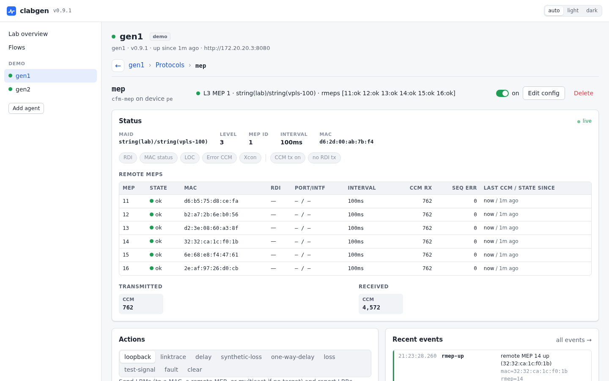
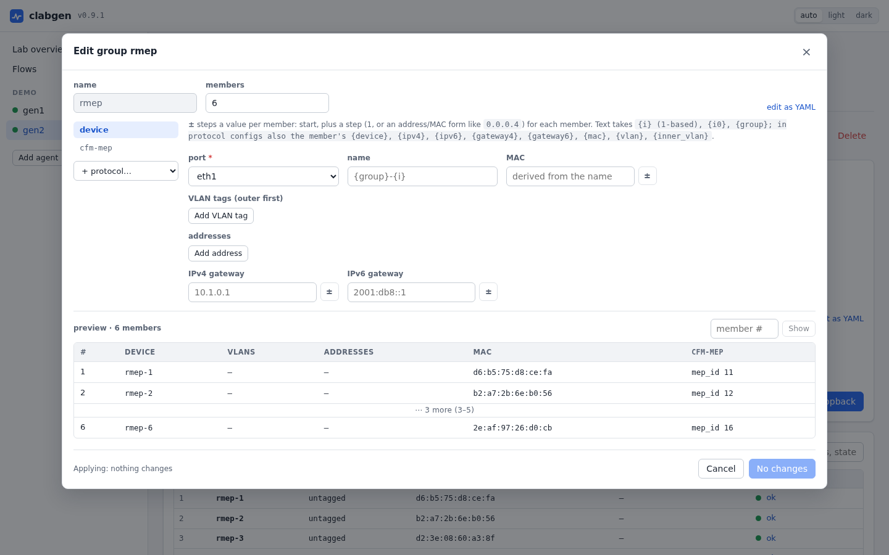
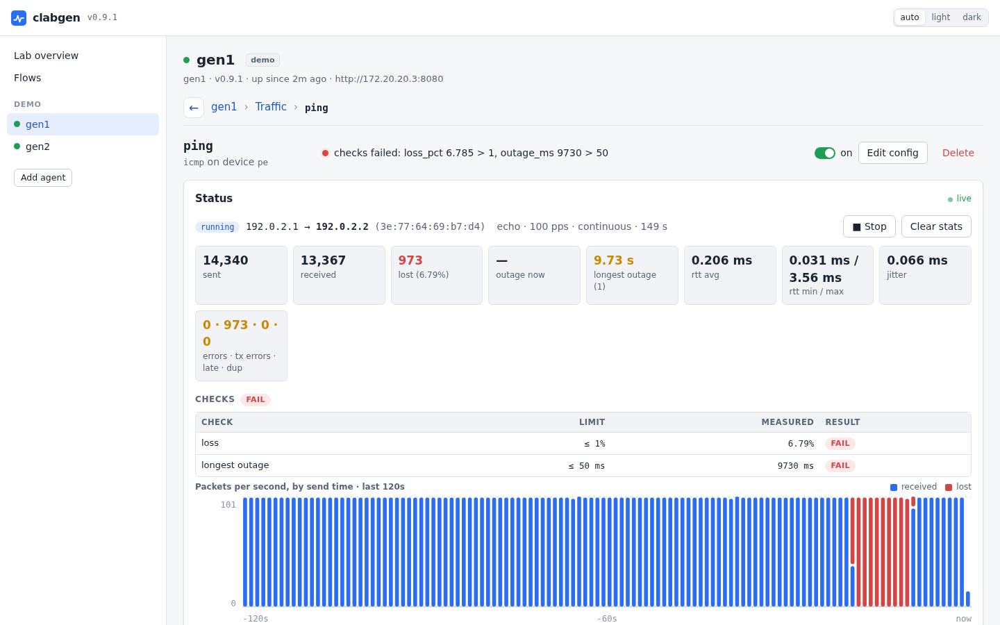
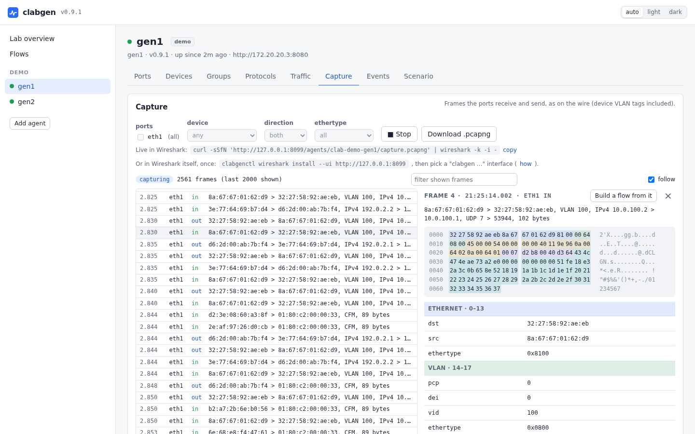

# Web UI

One `clabgen-ui` container per lab host shows every running containerlab
lab on the machine, much like Edgeshark. It finds the containerlab nodes
running a clabgen image through the Docker socket, and proxies the
browser's calls to them.

## Running it

```sh
docker run -d --name clabgen-ui --network host --restart unless-stopped \
  -v /var/run/docker.sock:/var/run/docker.sock ghcr.io/ripnet/clabgen-ui
```

Host networking lets it reach every lab's management bridge. Then open
http://127.0.0.1:8090.

### From another machine

The UI listens on localhost only, because the API has no authentication.
To reach it from a laptop, either:

- tunnel the one port: `ssh -L 8090:127.0.0.1:8090 labhost`, then open
  http://localhost:8090, or
- have it listen on every interface: add `-listen 0.0.0.0:8090` after the
  image name, then open `http://labhost:8090`. Only do this on a lab
  network.

### Options

Options go after the image name (or on the `clabgen-ui` binary that ships
in the agent image):

| Option | Default | |
|---|---|---|
| `-listen addr` | `127.0.0.1:8090` | the listen address |
| `-lab file` | | a containerlab topology file or lab directory to find agents in (repeatable) |
| `-agent [name=]host[:port]` | | an agent to add by address (repeatable) |
| `-docker mode` | `auto` | discovery through the Docker socket: `auto`, `on` or `off` |
| `-image regexp` | `clabgen` | the container images that count as agents |
| `-update-check=false` | | don't ask GitHub for newer releases |

## What's in it

### Lab overview

Every protocol on every agent in one table, worst first, with counts of
healthy, warning, faulty and waiting protocols. The left nav lists the
agents by lab.

### An agent

Each agent has tabs:

- **Ports**: admin state (a switch per port), oper state and counters.
- **Devices**: the emulated endpoints, with their IP neighbors and a ping
  shortcut. **Make group…** turns a device and its protocols into a
  device group.
- **Groups**: device groups, their members and the group editor.
- **Protocols**: with on/off switches, and enable or disable all.
- **Traffic**: the agent's flows, and the flows received here.
- **Capture**: the frames the ports receive and send.
- **Events**: the agent's events, live.
- **Scenario**: the whole config as YAML, where it is saved across lab
  restarts, and a reset to the topology's scenario.

### A protocol's page

Live status, the protocol's actions with their forms (loopback, flap,
fault injection, graceful restart, …) and recent events.

<picture>
  <source media="(prefers-color-scheme: dark)" srcset="images/protocol-dark.png">
  
</picture>

**Edit config** opens the config editor:

- sections per part of the config, and a field search;
- the changes reviewed before they are applied, with a note on whether
  they apply in place or restart the instance (see
  [editing a running protocol](configuration.md#editing-a-running-protocol));
- an agent's rejection shown on the fields it names.

Forms come from each protocol's schema, so new protocol types appear
without UI changes.

### Device groups

The group editor shows the member device and each group protocol's config
as forms:

- `±` on a number, address or MAC steps it per member.
- A live preview shows the first, second and last member as the agent
  renders them, and any other member you ask for.
- When editing, it lists the template's changes field by field, and how
  many members applying changes, adds or removes (the rest keep running).
- The whole group can also be edited as YAML.

<picture>
  <source media="(prefers-color-scheme: dark)" srcset="images/group-editor-dark.png">
  
</picture>

### Flows

The **Flows** page has every agent's traffic flows in one table, with
their pass/fail checks, counts of passing and failing flows, a "failing
only" filter, and start, stop and clear for all of them (or the ones the
filter shows).

A flow's own page has live loss, outage and RTT tiles, its checks, a
per-second timeline and a per-packet log. Here, a ping across a link that
was down for ten seconds:

<picture>
  <source media="(prefers-color-scheme: dark)" srcset="images/flow-dark.png">
  
</picture>

### Capture

The frames an agent's ports receive and send, live, with a one-line
decode each. Filter by port, device, direction or ethertype.

- Click a frame for its layers and bytes.
- **Build a flow from it** sends it again from the packet builder.
- **Download .pcapng** saves the frames for Wireshark, or copy the
  `curl … | wireshark -k -i -` line to watch the same capture live in
  Wireshark.
- With the [Wireshark plugin](cli.md#wireshark) installed, the agents'
  ports are capture interfaces in Wireshark itself.

<picture>
  <source media="(prefers-color-scheme: dark)" srcset="images/capture-dark.png">
  
</picture>

### Packet editor

For packet flows, the editor shows the layers as cards to add, reorder,
edit and remove (or a template to start from), and a live preview from
the device: the frame as hex, coloured by layer, with each field's value.

- Hovering a field shows its bytes.
- **+ modifier** changes a field per packet, and the arrows step through
  packets to see the modifiers work.
- **Import pcap…** lists a capture's frames: replay them all, or open one
  as layers to edit.

## Versions

The header shows the version serving the UI. A release build of
`clabgen-ui` asks GitHub for the latest release every 6 hours (nothing
else is sent) and, when there is a newer one, links to it next to the
version. `-update-check=false` turns that off, for labs without internet
or that shouldn't call out. To update, see [Upgrading](upgrading.md).

Agents can run a different version than the UI (a lab deployed before an
update):

- An agent on an older release gets an **update** marker in the left nav,
  and the overview says how many there are: a newer UI may use things such
  an agent doesn't have yet. Redeploy the lab with the newer image to
  update it.
- An agent newer than the UI is marked **newer**.
- Development builds aren't compared; the agent's page shows both
  versions.

## Each agent's own UI

Every agent also serves the UI for itself on its API port,
`http://<agent-mgmt-ip>:8080/`. Other agents can be added there by
address.
